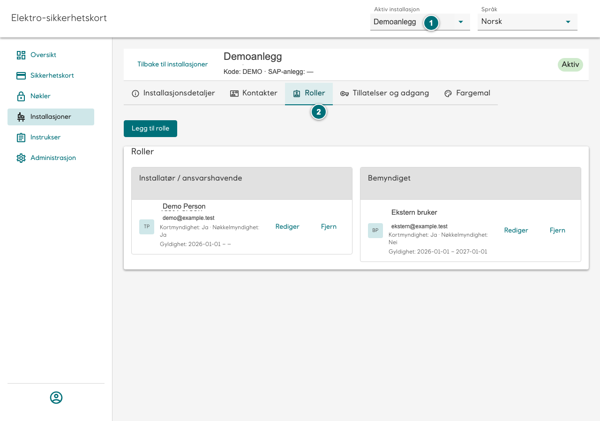
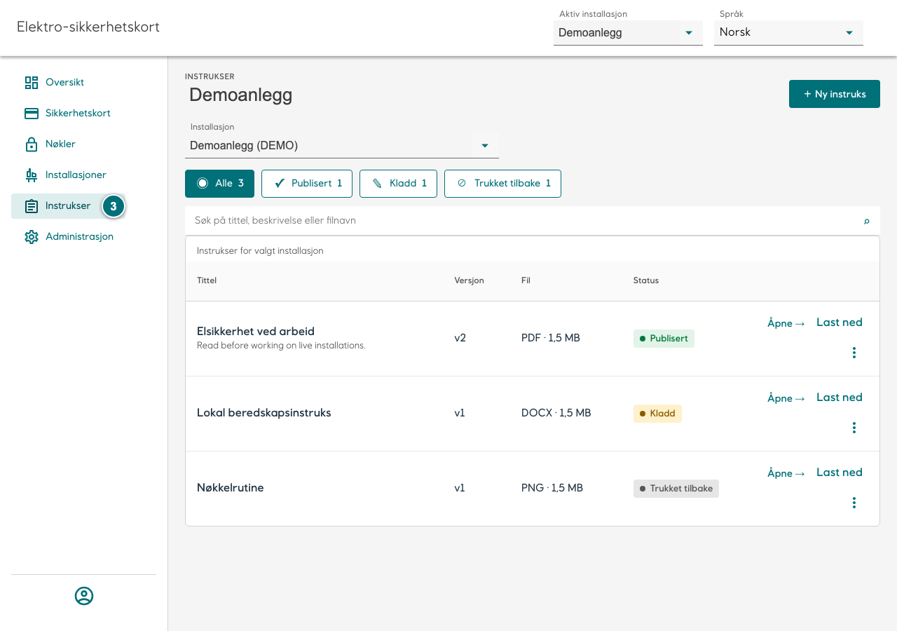
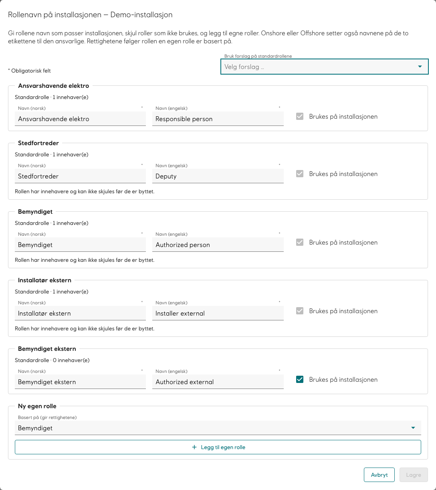
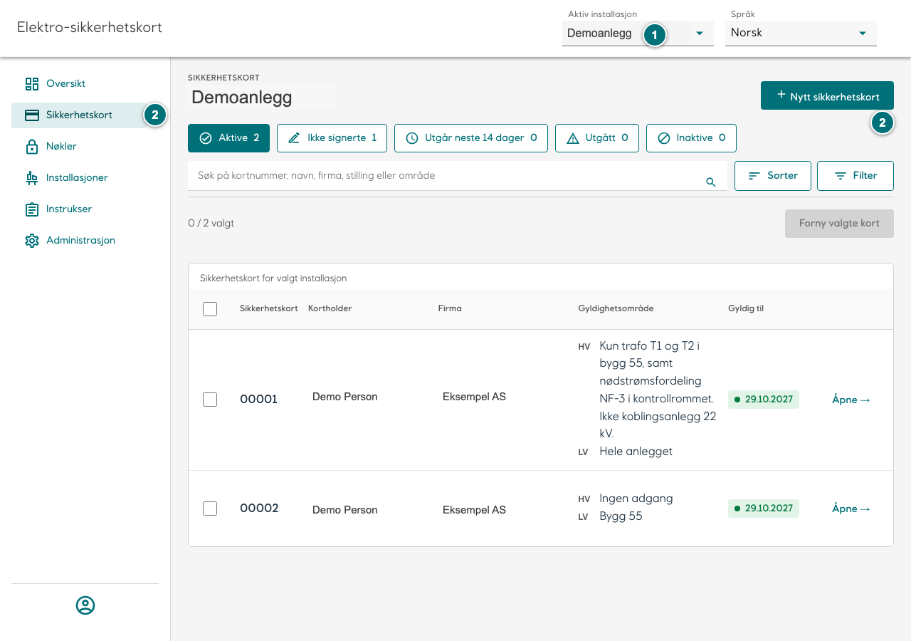
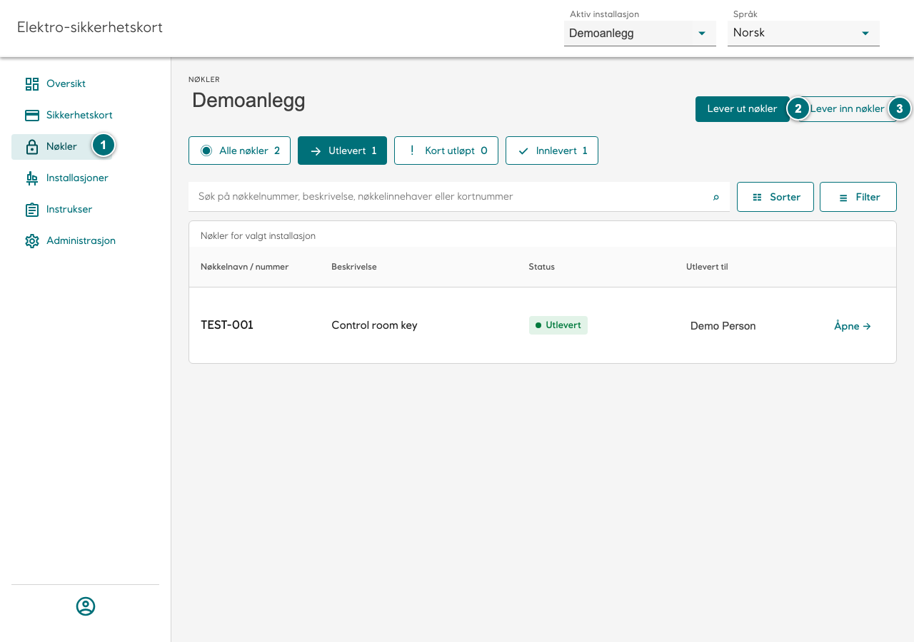
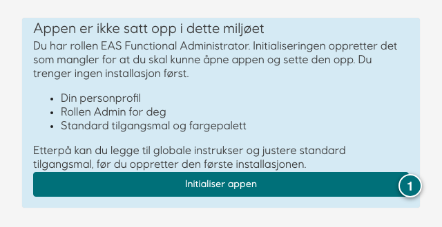
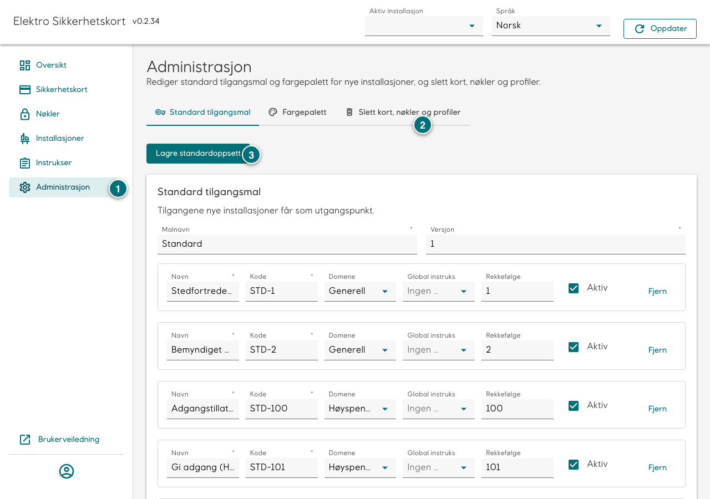
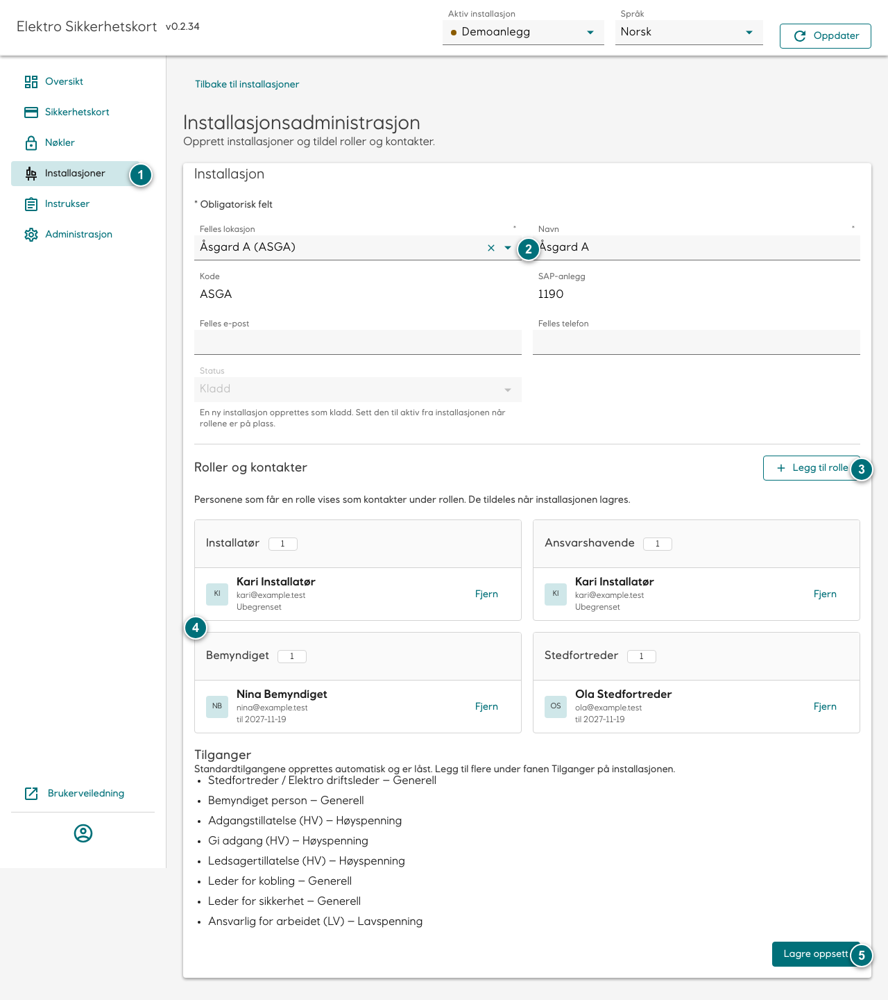
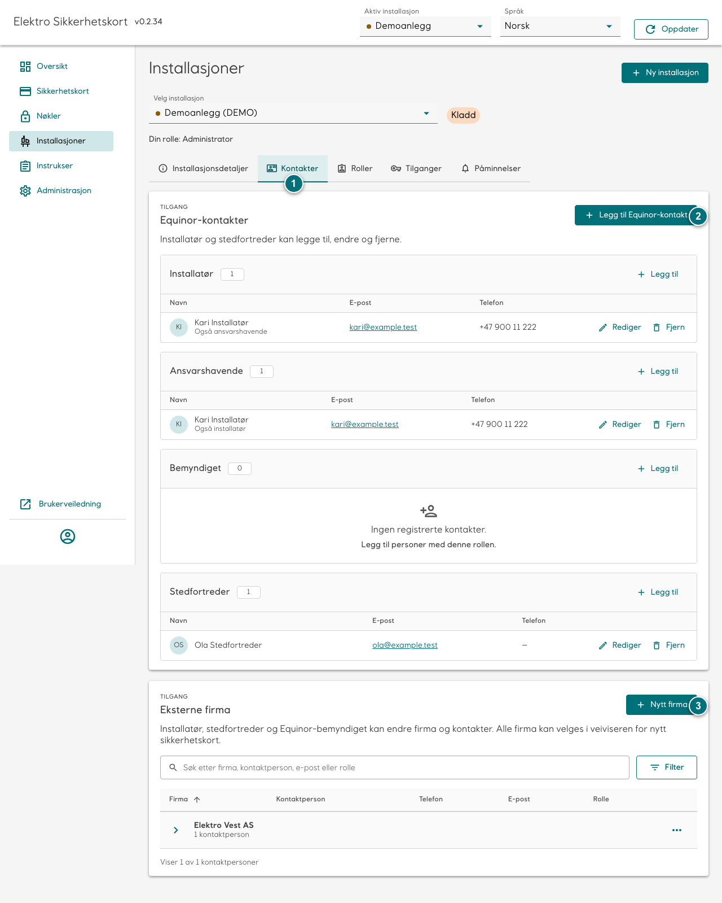
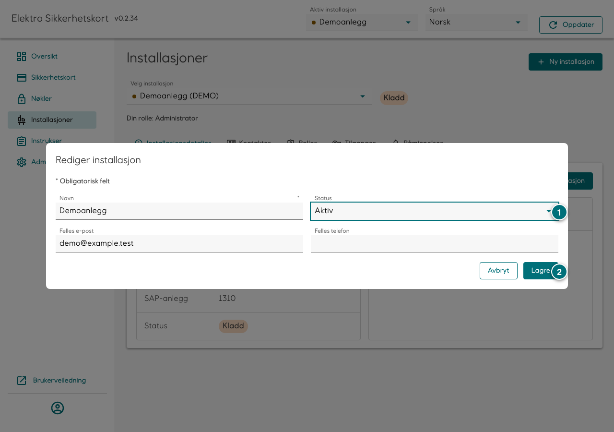

# Quick guides - Electrical safety cards

These guides describe features available in the current app. Menu labels appear
in Norwegian or English depending on the language selected in your profile. You
must sign in with an Equinor account to use the app. The actions available to you
depend on the role and authority assigned to you for the selected installation.

The screenshots show representative test views with synthetic, anonymised data.
The numbered circles refer to the steps in the text; the same number may appear
in more than one place within a step. Appearance and available actions may vary
with your role, the selected installation and the app version. The screenshots
use Norwegian labels.

Role names are set per installation. The guides use the standard (Onshore)
names; an offshore installation may, for example, call the electrically
responsible role **Electrical Operation manager**. The names can be changed, see
step 4 in
[1. Installer](#1-installer---prepare-and-follow-up-the-installation).
Authority always follows the role, never the name. "Installer" is used as the
general term for the role of the electrically responsible person.

## Open the app

Test: https://apps.equinor.com/eas20test

Production: Coming soon

## 1. Installer - prepare and follow up the installation

**Prerequisite:** An Admin/Superuser has created and activated the installation
and assigned you the **Installer / person in charge** role. If the installation
or role is missing, contact an Admin/Superuser. If you are an administrator
yourself, see [6. Administrator - get started](#6-administrator---get-started).

1. Select the correct installation using the selector at the top of the app.
2. Open **Installations**, select the installation and review the tabs:
   - **Details:** Check that you are viewing the correct installation. Changes
     to the installation's basic configuration and status are made by an
     Admin/Superuser.
   - **Contacts:** Keep Equinor contacts, external companies and contact persons
     up to date. The Installer and Deputy can maintain Equinor contacts. The
     Installer, Deputy and Authorized person can maintain external companies and
     contacts.
   - **Roles:** Assign or revoke roles as needed. Set the correct card
     authority, key authority and validity period. External roles must be
     linked to the correct company. Only delegate authority that you are
     permitted to delegate. Role names can be adapted to the installation; see
     step 4.
   - **Permissions:** Check the default permissions, add any necessary
     installation-specific permissions and maintain their order and associated
     instructions. Changes to the shared permission catalogue should be
     carefully considered; cardholders may need to sign again when their card's
     permissions change.

*Figure 1. Select the installation (1), then open the appropriate tab under Installations (2).*

3. Open **Instructions** for the installation. Create or edit an instruction,
   upload a new file version or add a link, and publish it once it has been
   checked. Only published instructions are current for normal viewing.
   Instructions are a separate library, not part of card signing.

*Figure 2. Open Instructions in step 3.*

4. Adapt the role names if needed. Open the **Roles** tab and select **Edit
   role names**. The button is shown to Admin, Installer and Deputy, not to
   Authorized person.
   - Select a suggestion, **Onshore** or **Offshore**, to fill in the standard
     names, or type your own. A name is required in both Norwegian and
     English, can have at most 80 characters and must be unique on the
     installation.
   - Clear **Used on the installation** for a role that is not used. Installer
     cannot be hidden, and a role with holders cannot be hidden until the
     holders have been changed.
   - Select **Add custom role** to create a new role. Choose the role it is
     **Based on**; it gets the same authority as that role, and the name never
     adds authority. You can have at most ten custom roles, and a custom role
     with holders cannot be removed.
   - Select **Save**. The names are used in role pickers, contact groups,
     reminders and role-expiry emails. Hidden roles no longer appear on the
     installation. A person with a custom role gets reminders like the role it
     is based on.

*Figure 3. The Edit role names dialog, opened from the Roles tab.*

5. Return to **Installations > Reminders**. Set up who should receive email,
   how often it should be sent and whether it should cover expired cards,
   cards nearing expiry or keys that have not been returned. No email is sent
   when there is nothing to report.
6. Check that the roles, contact information, permissions, published
   instructions and reminders are correct before starting normal operations.

The Installer and Deputy have the same installation-specific authority in the
app. They can manage the installation's roles and instructions. They cannot
change global default configuration or perform Admin/Superuser functions.

## 2. Issue safety cards and manage keys

**Prerequisite:** You have card authority and/or key authority for the
installation. Check the installation selector before starting; selecting an
installation does not in itself grant permission.

### Create a card

1. Select the correct installation using the installation selector at the top
   of the app.
2. Open **Safety cards** and select **New safety card**.

*Figure 4. Select the installation (1), then open the page and start the wizard (2).*

3. Find the person in the Office 365 directory if they have an Equinor account.
   Select **External without Equinor account** for a recipient without an
   account. Fill in any missing personal and company information.
4. Enter the validity dates and the date of the most recently completed FSE
   course. Specify the **Validity area** for high voltage and low voltage.
5. Select the card's **Permissions**, or explicitly select **No permissions**.
6. Select keys that have already been returned, register new keys to be handed
   out, or explicitly select **No keys handed out**.
7. Check the **Review** step and select **Complete and create card**. The card number
   is assigned automatically. Afterwards, check the signature status and any
   signing request in the card details.

There can only be one card per person per installation. Do not create a new
card if a card is still in force. A card that is no longer in force can be
reissued with the same card number; its previous history is retained.

### Renew cards

- A cardholder can request renewal from the card details. This is a request,
  not a renewal.
- With card authority, you can renew from the card details or select several
  cards in the card list and use **Renew selected cards**. Enter the FSE date
  and the new valid-to date. Check the result for each card; one card may fail
  even if others are renewed.
- Review the card history when you need to check previous changes or
  signatures.

### Hand out and take back keys

1. Open **Keys** and select **Hand out keys** or **Hand in keys**.

*Figure 5. Open Keys (1), then choose hand-out (2) or hand-in (3).*

2. When handing out a key, select an available key and link it to the correct
   active card. You can also register a new key and hand it out in the same
   workflow.
3. When taking back a key, select a key recorded as handed out. The return is
   recorded as a separate event; it does not overwrite the hand-out history.
4. Check the status and history in the key details. A key can be returned even
   if the associated card has expired.

You can send a new signing request from an unsigned card or key if you have the
appropriate authority. The recipient must confirm their own receipt; do not
sign on behalf of the cardholder.

## 3. Ordinary user - internal

**Prerequisite:** You are signed in with an Equinor account. As an ordinary
user, you can view your own information and perform actions for yourself. The
card and key lists may also show the installation's records in read-only mode;
this does not give you permission to change or sign other people's records.

1. Select the installation you want to view. **Overview** shows your relevant
   card/key tasks and any items awaiting your signature.
2. Open a card or key to view its details, validity, status and signature
   information.
3. When a signature is missing, select **Sign and accept** after checking the
   information. If you have received a Teams approval request, you can approve
   in Teams or sign in the app.

*Figure 6. Select the installation (1), find your tasks (2), and open signing (3).*

4. If you need a renewal, open the card and select **Request renewal**. A person
   with card authority must process the request. A request does not change the
   validity date until it has been processed.
5. Open **Instructions** to find published instructions for an installation.
   The card details may also link to relevant instructions.
6. From the card details, you can request a valid card as a PDF sent to the
   email address registered on the card.
7. Open **Profile** to save your preferred installation and language. You can also
   delete your profile there. It removes your name, email and link to your user,
   but the cards and history are kept. You cannot delete the profile while you
   have roles, safety cards in force, keys or open requests; contact an
   administrator. The next time you open the app you can create a new profile.

You can only sign receipt for your own cards and keys. If you cannot find your
card or an action you need, contact the installation's Installer / person in
charge.

## 4. Ordinary user - external

This guide applies to external personnel who have an Equinor account and sign
in to the app. As an ordinary user, follow the steps in **Ordinary user -
internal** for your own cards, signatures, renewal requests, instructions and
profile preferences. The overview in figure 6 also applies to external users;
the tasks and records you see depend on the installation and your role.

- Being registered as a cardholder or being able to sign in does not
  automatically grant card or key authority.
- You cannot create, change or renew other people's cards, hand out or take
  back other people's keys, or change the installation's roles and instructions
  without a specifically assigned role and authority.
- The card and key lists may show the installation's records in read-only mode.
  Signing and personal tasks apply to your own cards and keys; actions on other
  people's records require specific authority.

**Recipient without an Equinor account:** You are not a user of the app. When a
card or key is issued to you, you receive a signing link and a one-time code by
email. Open the link, enter the code in the form and confirm receipt. Use the
code before it expires, and do not share it. If the link or code is missing or
has expired, contact the person who issued the card or key for a new signing
request. This signing page does not grant access to the app or to other card
and key information.

## 5. External user with card and key authority

**Prerequisite:** You have an Equinor account and the **Installer external** or
**Authorized external** role for the correct installation, with card
and/or key authority assigned.

1. Select the installation where you have been assigned the role. Check that
   your company is shown as the company for the assignment.
2. Create and maintain cards through **Safety cards**, in the same way as in
   the guide for card issuers. You can only select or register people from your
   own company at installations where you have authority.
3. When renewing, process cards covered by your card authority. Enter the FSE
   and validity dates, and check the result for each card.
4. Hand out and take back keys through **Keys**. Link each key to the correct
   active card in your own company. Check the key status and history afterwards.
5. If the recipient's signature is missing, you can send a new signing request
   for a card or key within your authority. The recipient signs for themselves.

The screenshots in figures 4 and 5 show the same card and key pages. The actions
available to you are limited to the installation, company and authority
assigned to you.

Your authority only applies to the assigned installation and your own company.
It does not grant access to manage the installation's permissions, contacts,
instructions or roles. You can view the installation's other card and key lists
in read-only mode, but cannot perform actions on records outside your own
company and assigned authority. If you need extended or renewed authority,
contact the installation's Installer / person in charge. An external recipient
without an Equinor account follows only the signing instructions in the previous
section and cannot perform issuer tasks in the app.

## 6. Administrator - get started

**Prerequisite:** The environment administrator has given you the Dataverse
role **EAS Functional Administrator**, directly or through a team. Everyone who
holds this role is an administrator (Admin/Superuser) in the app for as long as
they hold it. The role does not grant Dataverse administrator rights.

1. Open the app. If it has not been set up in the environment, you see **The
   app is not set up in this environment**. Select **Initialize the app**. This
   creates your person profile, the Admin role for you, and the standard access
   template and color palette. You do not need an installation first.
   Initialization only fills in what is missing. If you are not the first
   administrator, the app instead asks you to create your profile or select
   **Activate administrator access**.

*Figure 7. Select Initialize the app (1).*

2. Open **Administration** (1). **Default access template** holds the accesses
   that new installations start with, and **Color palette** holds the colors
   that mark them (2). Adjust if needed and select **Save default configuration**
   (3). The **Delete cards, keys and profiles** tab is only for deletions that
   must be done by an administrator, and requires a reason.

*Figure 8. Open Administration (1), choose a tab (2) and save your changes (3).*

3. Open **Instructions → Global** and add instructions that apply to all
   installations. Publish them once they have been checked. You can then link a
   global instruction to an access in the standard access template.
4. Open **Installations** (1) and select **New installation**. Select the
   **Shared site** (2). The name, code and SAP plant are filled in from the
   site, and you can change the name. Common email and phone are optional. If
   the site is not in the list, it must first be created as master data;
   contact the platform team. A new installation is always created as a
   **Draft**, and the standard accesses from the default access template are
   created automatically and are locked. Also select **Role names**:
   **Onshore** or **Offshore**. The choice is required and decides the names of
   the roles and of the two labels of the electrically responsible role
   (Onshore: Local representative and Responsible person electrical facilities,
   Offshore: Electrical Operation manager and Responsible person electrical
   facilities). The names can be changed later under **Roles** with **Edit role
   names**; see [step 4 in guide 1](#1-installer---prepare-and-follow-up-the-installation).
5. Add the people who will hold roles on the installation. Under **Roles and
   contacts**, select **Add role** (3):
   1. Enter at least two characters of the name or email address and select
      **Search**.
   2. Select the person in the **Person** list.
   3. Select the **Role**: one of the two labels (for example **Local
      representative** or **Responsible person electrical facilities** onshore),
      **Authorized person** or **Deputy**.
   4. Fill in **Valid to**. For the two labels the field can be empty
      (unlimited). Authorized person and Deputy must have an end date;
      the app proposes one year ahead.
   5. Select **Add**. Repeat for each person and role. The same person can
      have both labels; add the person under both.

   The people show as contacts under the role (4). They get card and key
   authority on the installation. As a minimum, add one person under one of
   the two labels, and preferably a Deputy. You can remove a person with
   **Remove** before you save.

*Figure 9. Open Installations (1), select the site (2), add roles (3), check them (4) and save (5).*

6. Select **Save setup** (5). The installation is created as a Draft and the
   roles are assigned. If a role could not be assigned, the app shows who it
   concerns; add the person again under **Contacts** on the installation (next
   step).
7. Complete the contacts and roles on the installation. After saving, the
   installation opens. Open the **Contacts** tab (1):
   - **Equinor contacts:** Select **Add Equinor contact** (2), or **Add** in
     the role's group. Use **Edit** to enter a phone number or change the
     validity, and **Remove** to remove a person.
   - **External companies:** Select **New company** (3). In step 1, enter the
     company name. In step 2, add contact people and, if needed, an external
     role (**Installer external** or **Authorized external**). External
     roles are linked to the company and only apply to people in their own
     company. You can also add a contact person without a role, and people who
     are not in the directory can be entered manually.
   - The **Roles** tab shows what each role can do and who holds it, and lets
     you assign (**Assign role**) or revoke (**Revoke**) roles. Roles appear
     with the installation's own names; use **Edit role names** to change them.

*Figure 10. Open Contacts (1), add Equinor contacts (2) and external companies (3).*

8. Check the **Accesses** tab. The standard accesses are already in place and
   locked. Add installation-specific accesses if needed, and link them to
   instructions.
9. Activate the installation. Open the **Installation details** tab, select
   **Edit installation**, set **Status** to **Active** (1) and select **Save**
   (2). Activation requires at least one contact (a person with a role counts)
   and one active access.

*Figure 11. Set Status to Active (1) and save (2).*

10. Tell the installer, who continues with
    [1. Installer](#1-installer---prepare-and-follow-up-the-installation) to
    set up reminders and instructions and start normal operations.

More administrators are added by the environment administrator giving them the
**EAS Functional Administrator** role. If the role is removed, the person loses
the administrator rights.
