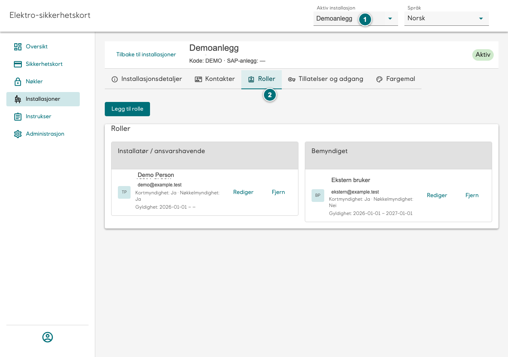
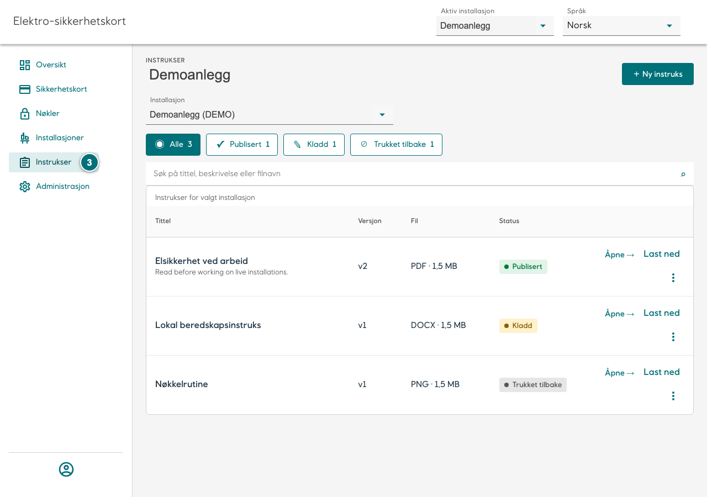
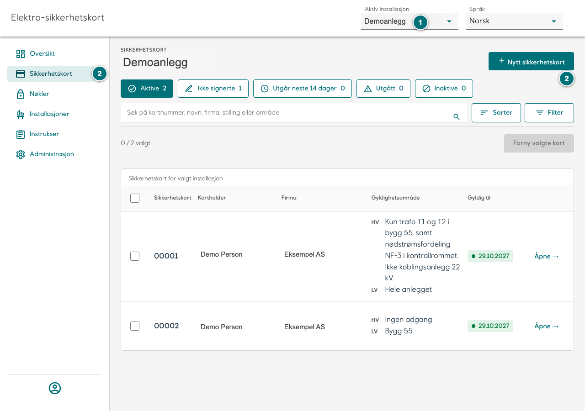
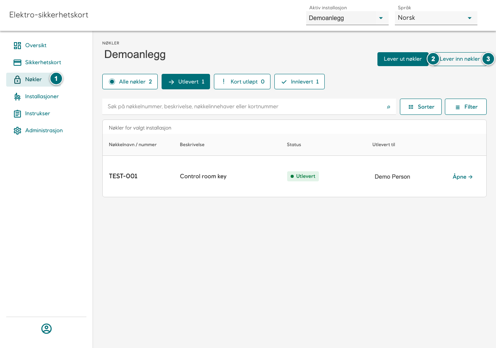
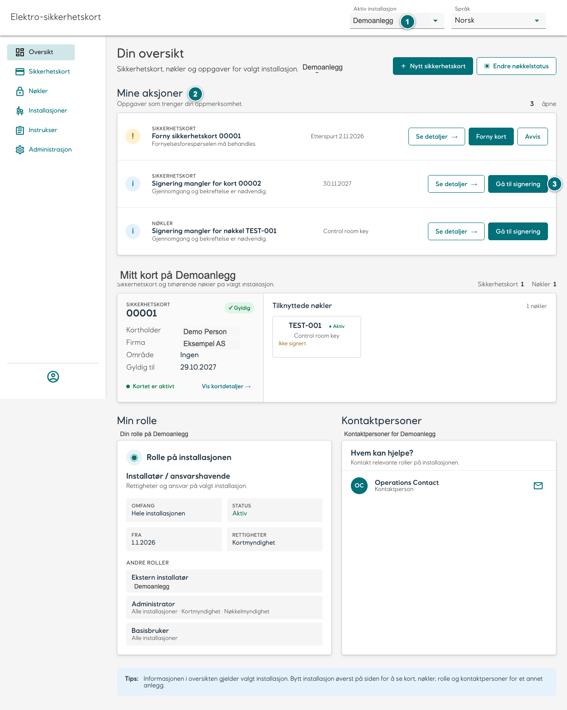

# Elektro-sikkerhetskort

Guidene beskriver funksjoner som finnes i dagens app. Menynavn vises på norsk
eller engelsk avhengig av språkvalget i profilen. Du må være logget inn med
Equinor-konto for å bruke appen. Hvilke handlinger du kan utføre, avhenger av
rollen og myndigheten du har fått på den valgte installasjonen.

Skjermbildene er representative testvisninger med syntetiske, anonymiserte
opplysninger. Sirkelmarkørene viser til trinnnumrene i teksten; samme nummer
kan markere flere steder i ett trinn. Utseende og tilgjengelige handlinger kan
variere med rolle, valgt installasjon og appversjon.

## 1. Installatør – klargjøre og følge opp installasjonen

**Forutsetning:** Admin/Superbruker har opprettet og aktivert installasjonen og
tildelt deg rollen **Installatør / ansvarshavende**. Hvis installasjonen eller
rollen mangler, kontakt Admin/Superbruker.

1. Velg riktig installasjon i velgeren øverst i appen.
2. Åpne **Installasjoner**, velg installasjonen og gå gjennom fanene:
   - **Detaljer:** Kontroller at du er på riktig installasjon. Endring av
     installasjonens grunnoppsett og status gjøres av Admin/Superbruker.
   - **Kontakter:** Hold Equinor-kontakter, eksterne firma og kontaktpersoner
     oppdatert. Installatør og Stedfortreder kan vedlikeholde
     Equinor-kontakter. Installatør, Stedfortreder og Bemyndiget kan
     vedlikeholde eksterne firma og kontakter.
   - **Roller:** Tildel eller opphev roller etter behov. Sett riktig
     kortmyndighet, nøkkelmyndighet og gyldighetsperiode. Eksterne roller må
     knyttes til riktig firma. Deleger bare myndighet du selv har anledning til
     å delegere.
   - **Tilganger:** Kontroller standardtilgangene, legg til nødvendige
     installasjonsspesifikke tilganger og hold rekkefølge og tilknyttede
     instrukser oppdatert. Endringer i felles tilgangskatalog skal være
     gjennomtenkt; kortinnehavere kan måtte signere på nytt når kortets
     tilganger endres.

*Figur 1. Velg installasjonen (1), og åpne riktig fane under Installasjoner (2).*

3. Åpne **Instrukser** for installasjonen. Opprett eller rediger instruks,
   last opp en ny filversjon eller legg til en lenke, og publiser den når den
   er kontrollert. Bare publiserte instrukser er gjeldende for vanlig visning.
   Instrukser er et eget bibliotek, ikke en del av kortsigneringen.

*Figur 2. Åpne Instrukser i trinn 3.*

4. Gå tilbake til **Installasjoner → Påminnelser**. Sett opp hvem som skal få
   e-post, hvor ofte den skal sendes og om den skal gjelde utløpte kort,
   kort som snart utløper eller nøkler som ikke er levert inn. Ingen e-post
   sendes når det ikke finnes noe å rapportere.
5. Kontroller at rollene, kontaktinformasjonen, tilganger, publiserte instrukser
   og påminnelser er riktige før du begynner ordinær drift.

Installatør og Stedfortreder har samme installasjonsspesifikke myndighet i
appen. De kan administrere installasjonens roller og instrukser. De kan ikke
endre global standardkonfigurasjon eller utføre Admin/Superbruker-funksjoner.

## 2. Utstede sikkerhetskort og håndtere nøkler

**Forutsetning:** Du har kortmyndighet og/eller nøkkelmyndighet på installasjonen.
Sjekk installasjonsvelgeren før du starter; valg av installasjon er ikke i seg
selv en tillatelse.

### Opprette et kort

1. Velg riktig installasjon i installasjonsvelgeren øverst i appen.
2. Åpne **Sikkerhetskort** og velg **Nytt sikkerhetskort**.

*Figur 3. Velg installasjonen (1), og åpne siden og start veiviseren (2).*

3. Finn personen i Office 365-katalogen når vedkommende har Equinor-konto.
   Velg **Ekstern uten Equinor-konto** for en mottaker uten konto. Fyll inn
   person- og firmaopplysninger som mangler.
4. Fyll ut gyldighetsdatoer og siste fullførte FSE-kurs. Angi
   **Gyldighetsområde** for høyspenning og lavspenning.
5. Velg kortets **Tilganger**, eller velg uttrykkelig **Ingen tilganger**.
6. Velg nøkler som allerede er innlevert, registrer nye nøkler som skal deles
   ut, eller velg uttrykkelig **Ingen nøkler utlevert**.
7. Gå gjennom **Kontroll** og velg **Fullfør og opprett kort**. Kortnummeret
   tildeles automatisk. Kontroller etterpå signaturstatus og eventuell
   signeringsforespørsel i kortdetaljene.

Det kan bare finnes ett kort per person og installasjon. Hvis et kort fortsatt
er i kraft, må det ikke opprettes et nytt. Et kort som ikke lenger er i kraft,
kan utstedes på nytt med samme kortnummer; tidligere historikk beholdes.

### Fornye kort

- En kortholder kan be om fornyelse fra kortdetaljene. Det er en forespørsel,
  ikke en fornyelse.
- Med kortmyndighet kan du fornye fra kortdetaljene eller velge flere kort i
  kortlisten og bruke **Forny valgte kort**. Oppgi FSE-dato og ny
  gyldig-til-dato. Kontroller resultatet for hvert kort; ett kort kan feile
  selv om andre blir fornyet.
- Gå gjennom kortets historikk når du må kontrollere tidligere endringer eller
  signeringer.

### Dele ut og ta imot nøkler

1. Åpne **Nøkler** og velg **Lever ut nøkler** eller **Lever inn nøkler**.

*Figur 4. Åpne Nøkler (1), og velg utlevering (2) eller innlevering (3).*

2. Ved utlevering velger du en tilgjengelig nøkkel og knytter den til riktig
   aktivt kort. Du kan også registrere en ny nøkkel og levere den ut i samme
   arbeidsflyt.
3. Ved innlevering velger du nøkkel som står som utlevert. Innleveringen
   registreres som en egen hendelse; den overskriver ikke utleveringshistorikken.
4. Kontroller status og historikk i nøkkeldetaljene. En nøkkel kan leveres inn
   selv om det tilknyttede kortet har utløpt.

Du kan sende en ny signeringsforespørsel fra et usignert kort eller en usignert
nøkkel når du har riktig myndighet. Det er mottakeren som bekrefter sitt eget
mottak; ikke signer på vegne av kortholderen.

## 3. Vanlig bruker – intern

**Forutsetning:** Du er logget inn med Equinor-konto. Som vanlig bruker kan du
se egne opplysninger og utføre handlinger som er rettet mot deg selv. Kort- og
nøkkellistene kan også vise installasjonens poster i skrivebeskyttet modus;
det gir ikke rett til å endre eller signere andres poster.

1. Velg installasjonen du vil se. **Oversikt** viser dine relevante
   kort-/nøkkeloppgaver og eventuelle ting som venter på signaturen din.
2. Åpne et kort eller en nøkkel for å se detaljer, gyldighet, status og
   signaturinformasjon.
3. Når en signatur mangler, velg **Signer og godta** etter at du har kontrollert
   opplysningene. Hvis du har fått en Teams-godkjenning, kan du godkjenne i
   Teams eller signere i appen.

*Figur 5. Velg installasjon (1), finn oppgavene dine (2), og åpne signeringen (3).*

4. Trenger du fornyelse, åpne kortet og velg **Be om fornyelse**. En person med
   kortmyndighet må behandle forespørselen. En forespørsel endrer ikke
   gyldighetsdatoen før den er behandlet.
5. Åpne **Instrukser** for å finne publiserte instrukser for en installasjon.
   Kortdetaljene kan også lenke til relevante instrukser.
6. Fra kortdetaljene kan du be om å få et gyldig kort sendt som PDF til
   e-postadressen som er registrert på kortet.
7. Åpne **Profil** for å lagre foretrukket installasjon og språk.

Du kan bare signere mottak for egne kort og nøkler. Hvis du ikke finner kortet
eller en handling du trenger, kontakt installasjonens Installatør /
ansvarshavende.

## 4. Vanlig bruker – ekstern

Denne veiledningen gjelder eksterne personer som har Equinor-konto og logger
inn i appen. Som vanlig bruker følger du trinnene i **Vanlig bruker – intern**
for egne kort, signaturer, fornyelsesforespørsler, instrukser og profilvalg.
Oversiktsbildet i figur 5 gjelder også for eksterne brukere; hvilke oppgaver og
poster du ser, avhenger av installasjonen og rollen din.

- Du får ikke automatisk kort- eller nøkkelmyndighet av å være registrert som
  kortholder eller av å kunne logge inn.
- Du kan ikke opprette, endre eller fornye andres kort, dele ut eller ta imot
  andres nøkler, eller endre installasjonens roller og instrukser uten en
  særskilt tildelt rolle og myndighet.
- Kort- og nøkkellistene kan vise installasjonens poster i skrivebeskyttet
  modus. Signering og personlige oppgaver gjelder dine egne kort og nøkler;
  handlinger på andres poster krever særskilt myndighet.

**Mottaker uten Equinor-konto:** Du er ikke bruker av appen. Når et kort eller
en nøkkel er utstedt til deg, får du signeringslenke og engangskode på e-post.
Åpne lenken, skriv inn koden i skjemaet og bekreft mottaket. Bruk koden før den
utløper, og ikke del den videre. Hvis lenken eller koden mangler eller er
utløpt, kontakt personen som utstedte kortet eller nøkkelen for en ny
signeringsforespørsel. Denne signeringssiden gir ikke tilgang til appen eller
andre kort- og nøkkelopplysninger.

## 5. Ekstern med kort- og nøkkelmyndighet

**Forutsetning:** Du har Equinor-konto og rollen **Installatør ekstern** eller
**Bemyndiget ekstern** på riktig installasjon, med kort- og/eller
nøkkelmyndighet tildelt.

1. Velg installasjonen der du har fått rollen. Kontroller at firmaet ditt vises
   som firma for oppdraget.
2. Opprett og vedlikehold kort via **Sikkerhetskort**, på samme måte som i
   veiledningen for kortutstedere. Du kan bare velge eller registrere personer
   i eget firma på installasjoner der du har myndighet.
3. Ved fornyelse behandler du kort som omfattes av din kortmyndighet. Oppgi
   FSE- og gyldighetsdatoer, og kontroller resultatet per kort.
4. Del ut og ta imot nøkler via **Nøkler**. Knytt hver nøkkel til riktig aktivt
   kort i eget firma. Kontroller nøkkelstatus og historikk etterpå.
5. Hvis mottakerens signatur mangler, kan du sende en ny signeringsforespørsel
   for kort eller nøkkel som ligger innenfor din myndighet. Mottakeren signerer
   selv.

Skjermbildene i figur 3 og 4 viser de samme kort- og nøkkelsidene. Hvilke
handlinger du kan utføre, avgrenses til installasjonen, firmaet og myndigheten
du er tildelt.

Din myndighet gjelder bare tildelt installasjon og eget firma. Den gir ikke
tilgang til å administrere installasjonens tilganger, kontakter, instrukser
eller roller. Du kan se installasjonens øvrige kort- og nøkkellister i
skrivebeskyttet modus, men kan ikke utføre handlinger på poster utenfor eget
firma og tildelt myndighet. Hvis du trenger utvidet eller fornyet myndighet,
kontakt installasjonens Installatør / ansvarshavende. En ekstern mottaker uten
Equinor-konto følger bare signeringsinstruksen i forrige avsnitt og kan ikke
utføre utstederoppgaver i appen.
