# Brukerveiledning – oBeReady

oBeReady hjelper deg å planlegge og gjennomføre trening på operasjonelle
barriereelementer (OBE). Du velger et scenario (DFU), bestemmer hvilke OBE-er
dere skal trene på, setter ansvarlige for rollene, sender ut egenforberedelse,
gjennomfører table-top og øvelse, og samler inn evaluering. Appen har også en
treningsmatrise og årlig utsjekk av dine OBE-er.

Du logger inn med Equinor-kontoen din. Hva du får lov til å gjøre, avhenger av
rollen din.

**Om bildene:** Skjermbildene viser oppdiktede eksempeldata. Ingen av navnene,
anleggene eller treningene er ekte. De røde sirklene med tall viser til
punktene med samme nummer i teksten. Det du ser i appen, kan se litt
annerledes ut, avhengig av rollen din og hvilken versjon du bruker.

## Åpne appen

Prod: Kommer

## 1. Kom i gang

### Godta personvernerklæringen

Første gang du åpner appen, ser du personvernerklæringen. Den forteller hvilke
opplysninger appen bruker, og hvorfor.

1. Les gjennom teksten, og velg **Godta**.

Velger du **Avslå**, kan du ikke bruke appen før du godtar.

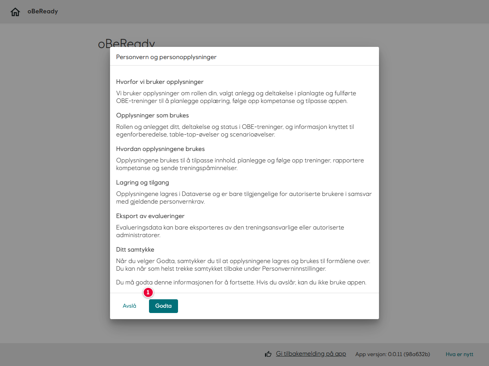

### Velg anlegg

1. Velg anlegget du jobber på, i listen **Anlegg**.
2. Velg **Lagre og fortsett**.

Appen husker valget til neste gang. Anlegget vises øverst i appen.

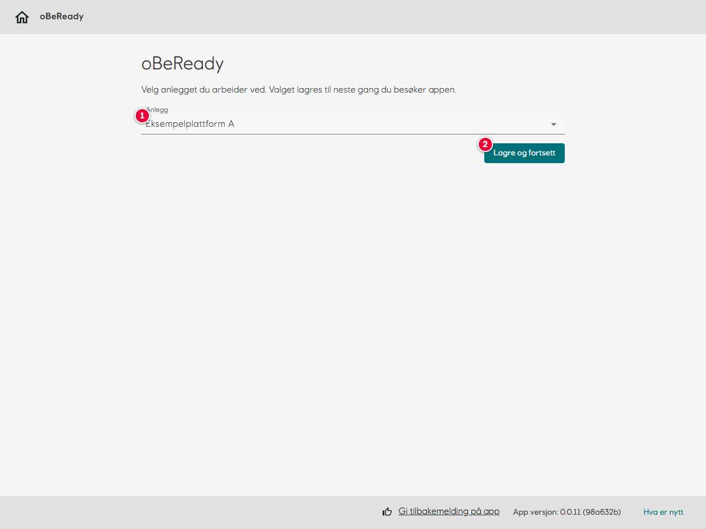

### Startsiden

Startsiden har tre valg:

1. **OBE-trening** – se treningene på anlegget, og planlegg nye.
2. **Treningsmatrise** – se hvilke OBE-er som hører til et scenario og en rolle.
3. **Årlig utsjekk per rolle** – bekreft at du kjenner OBE-ene for rollene dine.
4. **Tannhjulet** øverst til høyre åpner innstillingene.

Huset øverst til venstre tar deg alltid tilbake til startsiden.

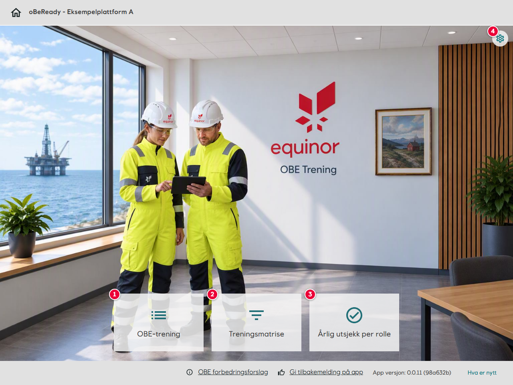

### Bytt anlegg eller endre personvern

Velg tannhjulet på startsiden. Da får du to valg:

1. **Endre anlegg** – velg et annet anlegg.
2. **Personverninnstillinger** – les erklæringen på nytt, eller trekk tilbake
   samtykket.

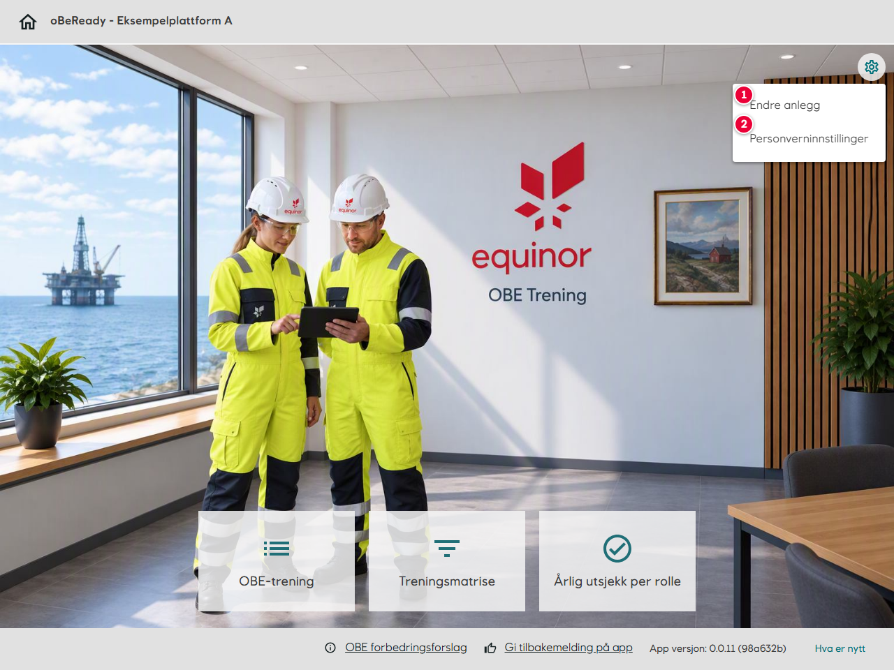

## 2. Finn en trening

Velg **OBE-trening** på startsiden. Du ser treningene på anlegget ditt, de
nyeste først. Hver rad viser scenario, dato for trening, hvem som opprettet
den, og status:

- **Utkast** – treningen har ingen table-top-dato ennå.
- **Planlagt** – treningen har fått en table-top-dato.
- **Gjennomført** – treningen er markert som ferdig.

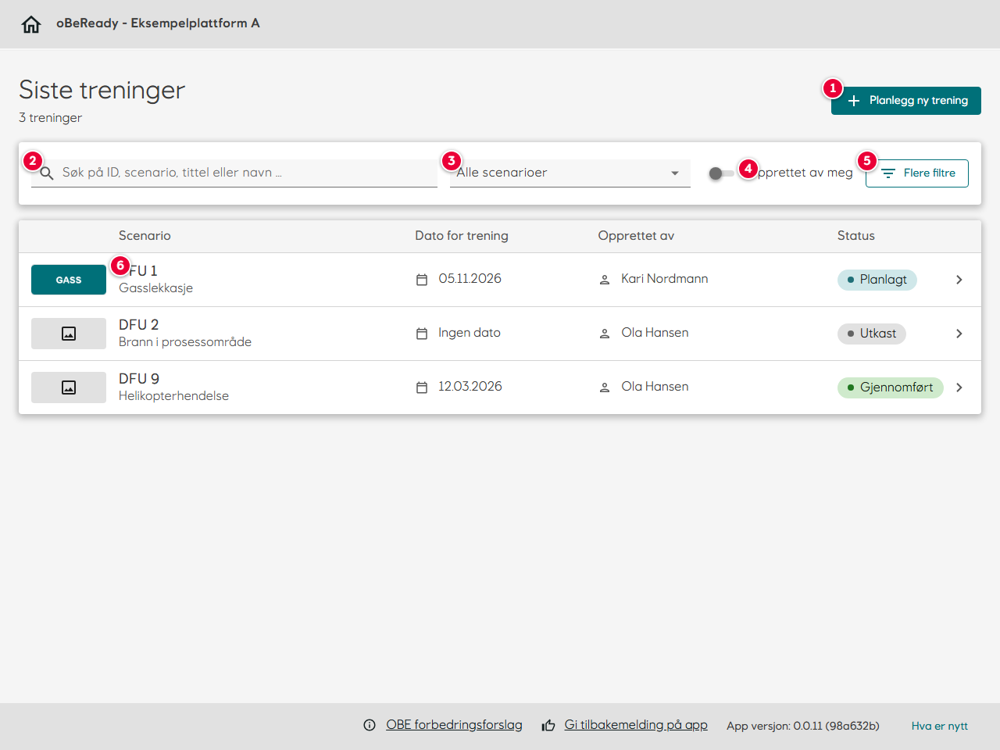

1. **Planlegg ny trening** – start en ny trening (se kapittel 3).
2. **Søk** – søk på ID, scenario, tittel eller navn.
3. **Alle scenarioer** – vis bare treninger for ett scenario.
4. **Opprettet av meg** – vis bare treningene du har laget.
5. **Flere filtre** – filtrer på status, dato for trening, hvem som opprettet
   treningen, og når den ble opprettet.
6. Velg en rad for å åpne treningen.

Under **Flere filtre** velger du først hva du vil filtrere på, og så verdiene.
Tallet på knappen viser hvor mange filtre som er i bruk. Velg **Nullstill
filtre** for å fjerne alle.

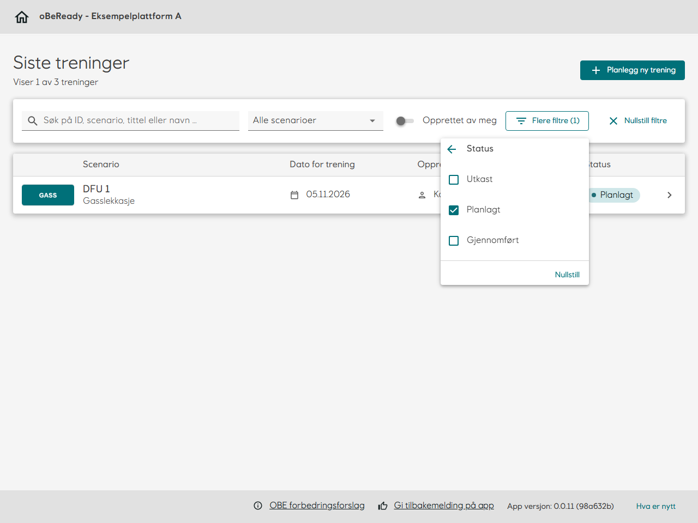

## 3. Planlegg en ny trening

1. Velg **OBE-trening** og deretter **Planlegg ny trening**.
2. Velg scenarioet (DFU) som er aktuelt for turen. Raden blir grønn når den er
   valgt.
3. Vil du se hvilke OBE-er scenarioet trener på anlegget ditt, velger du
   **OBE** på raden.
4. Velg **Neste**. Treningen blir opprettet som et utkast, og treningssiden
   åpnes.

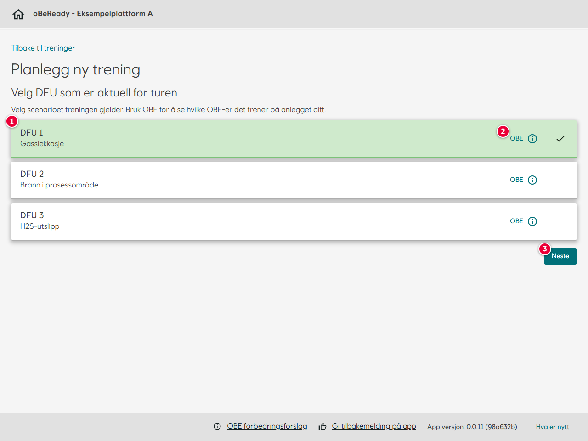

Når du velger **OBE**, ser du OBE-ene sortert etter Performance Standard, med
ansvarlige roller for hver OBE.

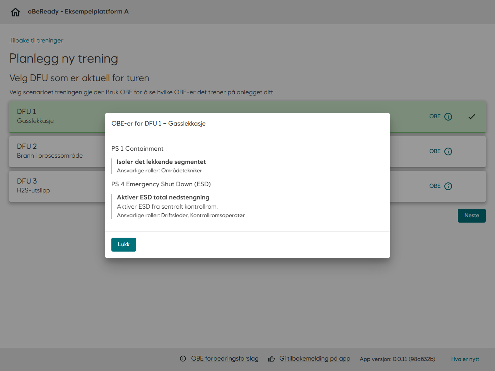

## 4. Treningssiden

Treningssiden er bygget opp som en prosess i sju steg. Du jobber deg gjennom
stegene fra venstre mot høyre, men du kan åpne et hvilket som helst steg når
som helst.

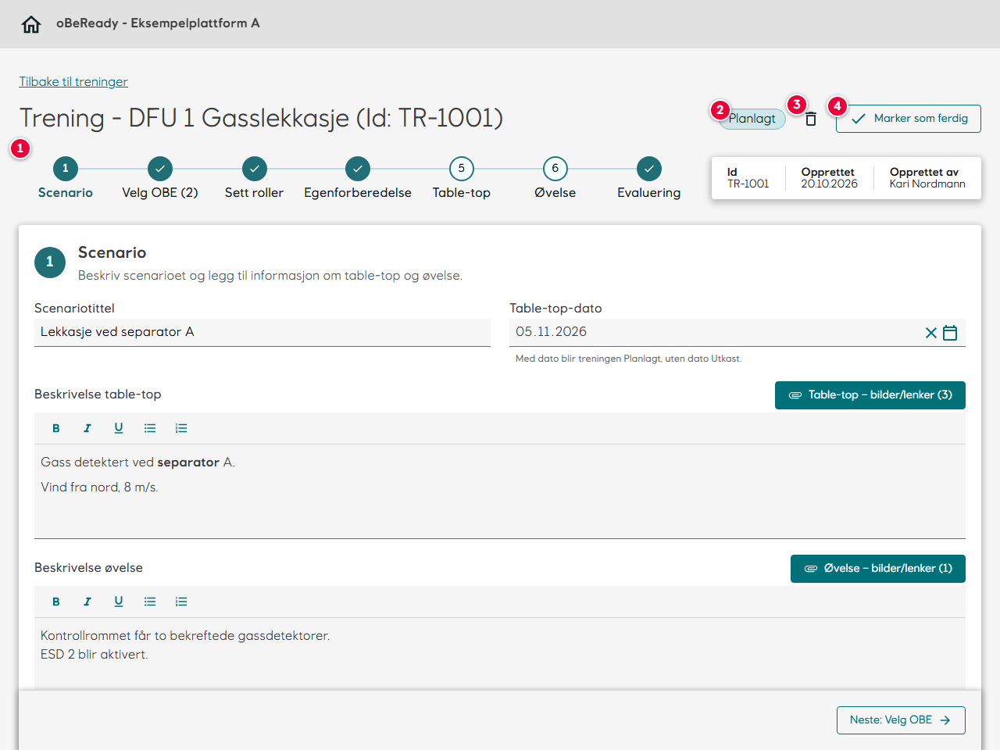

1. **Prosessraden** – velg et steg for å åpne det. Et steg med hake er ferdig.
   Tallet i parentes bak **Velg OBE** er antall valgte OBE-er.
2. **Status** – Utkast, Planlagt eller Gjennomført.
3. **Slett** – slett treningen (se kapittel 12).
4. **Marker som ferdig** – avslutt treningen (se kapittel 12).

Til høyre ser du treningens ID, når den ble opprettet og av hvem. Nederst på
siden er det knapper for **Forrige** og **Neste** steg.

**Tips:** Bare den som opprettet treningen, ser knappene **Slett** og
**Marker som ferdig**.

## 5. Steg 1 – Scenario

Her beskriver du hva treningen handler om. Alt du skriver, lagres automatisk
når du går ut av feltet.

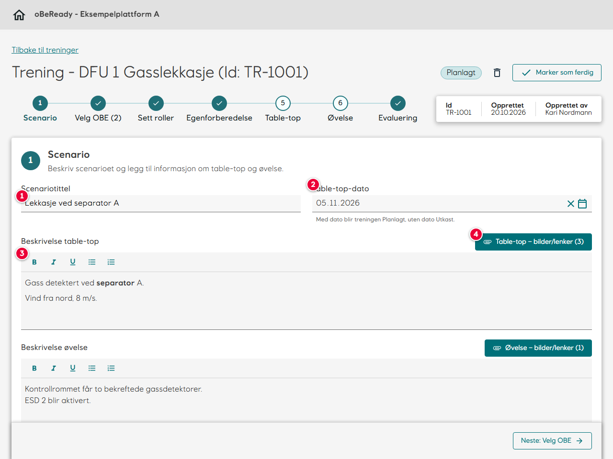

1. **Scenariotittel** – en kort tittel på scenarioet.
2. **Table-top-dato** – datoen for table-top. Med dato blir treningen
   *Planlagt*. Uten dato er den et *Utkast*.
3. **Beskrivelse table-top** – beskriv scenarioet. Bruk verktøylinjen for fet,
   kursiv, understreking og lister. Lenger ned på siden fyller du ut
   **Beskrivelse øvelse**, **Treningsmoment** og **Læringsmål** på samme måte.
4. **Table-top – bilder/lenker** – legg til bilder og lenker som skal vises i
   table-top. Tallet viser hvor mange det er. Øvelsen har en egen knapp lenger
   ned.

### Legg til bilder

1. Velg **Table-top – bilder/lenker** (eller **Øvelse – bilder/lenker**).
2. Velg **Legg til bilde**, og velg ett eller flere bilder (JPG, PNG, GIF, BMP
   eller TIFF, maks 30 MB).
3. Skriv en kort **Beskrivelse** til høyre. Den vises under bildet i
   presentasjonen.
4. Har du flere bilder, drar du dem i listen til venstre for å endre
   rekkefølgen.

Bruk **Slett bilde** for å fjerne et bilde.

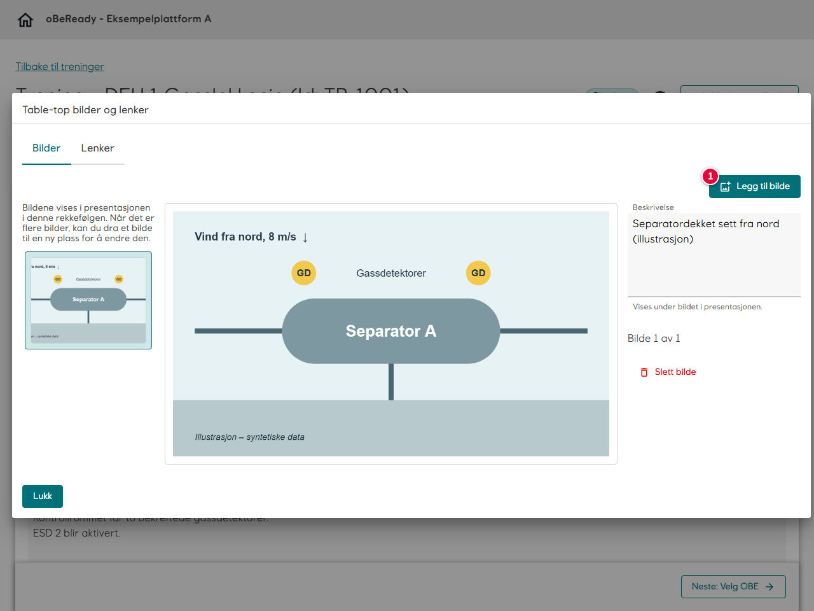

### Legg til lenker

1. Velg fanen **Lenker** i samme dialog.
2. Velg **Legg til lenke**.
3. Fyll ut tittel og full nettadresse (som begynner med https://), og velg om
   lenken skal vises på table-top, øvelse eller begge.

Anleggets WR1156-lenke ligger alltid øverst. Bruk blyanten for å endre en
lenke, og søppelbøtta for å slette den.

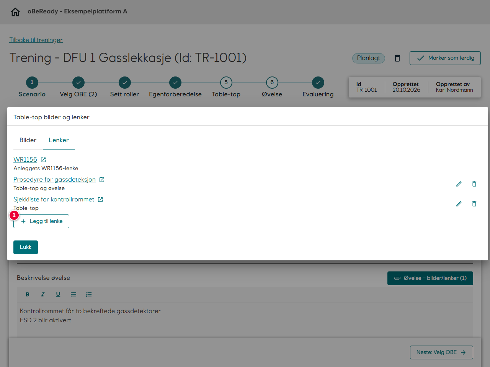

## 6. Steg 2 – Velg OBE

Her velger du hvilke OBE-er treningen skal fokusere på. Listene viser bare
OBE-ene som hører til scenarioet på anlegget ditt.

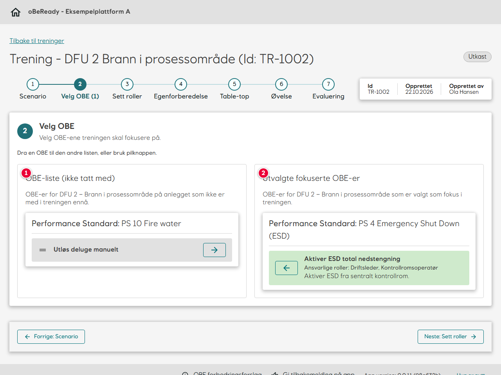

1. **OBE-liste (ikke tatt med)** – OBE-er som ikke er valgt ennå.
2. **Utvalgte fokuserte OBE-er** – OBE-ene treningen skal fokusere på.

Flytt en OBE ved å dra kortet til den andre listen, eller velg pilen på
kortet. Valget lagres med en gang.

**Merk:** Når egenforberedelsen er sendt ut, kan du ikke lenger endre OBE-ene.

## 7. Steg 3 – Sett roller

Rollene hentes fra OBE-ene du har valgt. For hver rolle velger du hvem som er
ansvarlig.

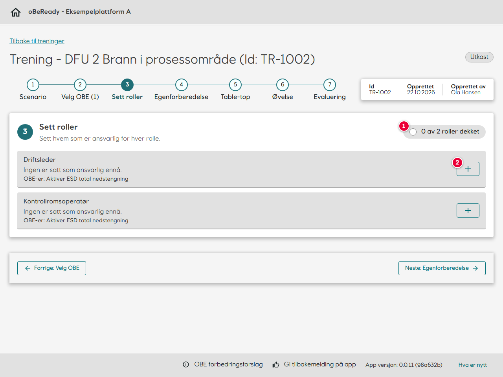

1. Merket øverst til høyre viser hvor mange roller som har en ansvarlig. Det
   blir grønt når alle rollene er dekket.
2. Velg **+** på en rolle for å velge personer.

### Velg personer til en rolle

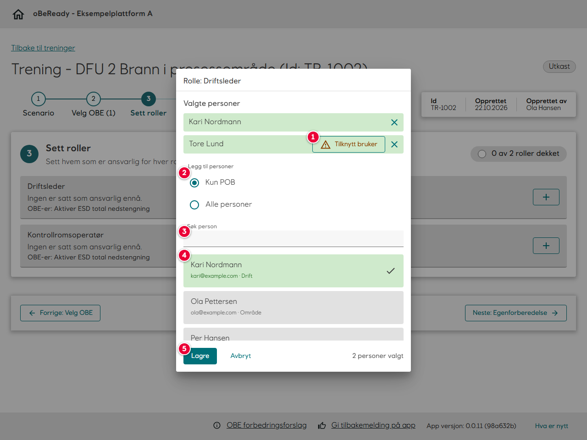

1. **Valgte personer** står øverst. En person med **Tilknytt bruker** er ikke
   koblet til en Equinor-bruker, og har ingen e-postadresse. Se neste avsnitt.
2. Velg **Kun POB** for å søke blant personer om bord, eller **Alle personer**
   for å søke blant alle brukere.
3. **Søk person** – skriv navnet. I **Alle personer** må du skrive minst to
   bokstaver.
4. Velg en person i listen. Valgte personer blir grønne med en hake. Velg
   personen igjen, eller krysset under **Valgte personer**, for å fjerne
   personen.
5. Velg **Lagre**.

Rollen viser nå hvem som er ansvarlig. Velg rolleknappen igjen for å endre.

### Tilknytt bruker

Noen personer på POB-listen er hentet fra DaWinci uten kobling til en
Equinor-bruker. De kan ikke få egenforberedelse før de er koblet.

1. Velg **Tilknytt bruker** på personen.
2. Appen søker opp navnet. Velg riktig person i listen.
3. Velg **Bekreft**.
4. Velg **Lagre** for å beholde personene du har valgt.

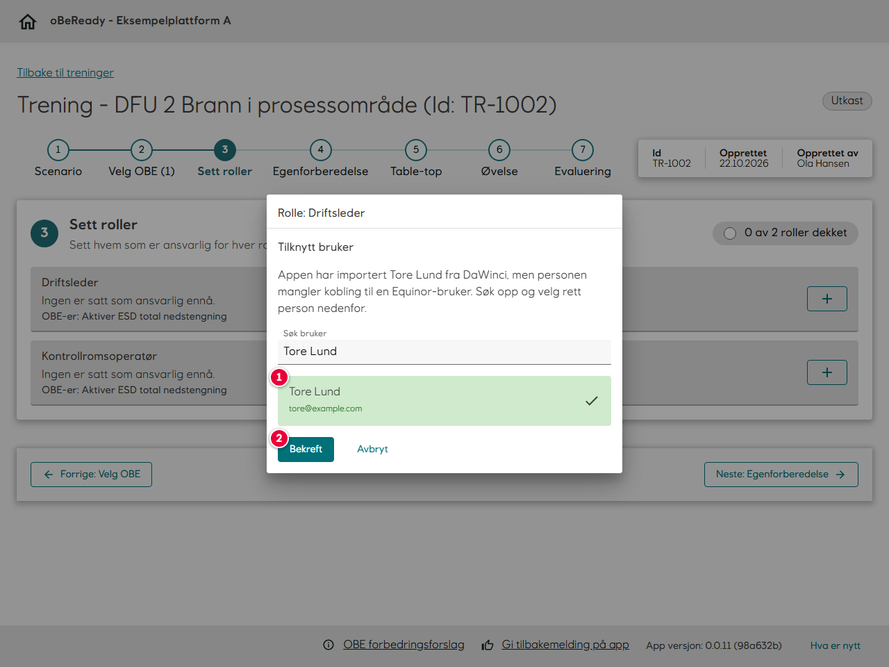

**Merk:** Når egenforberedelsen er sendt ut, er rollene låst.

## 8. Steg 4 – Egenforberedelse

Egenforberedelsen sendes som et kort i Teams til alle som er ansvarlige for en
rolle. Mottakerne bekrefter i Teams at de har gjort seg kjent med OBE-ene sine.

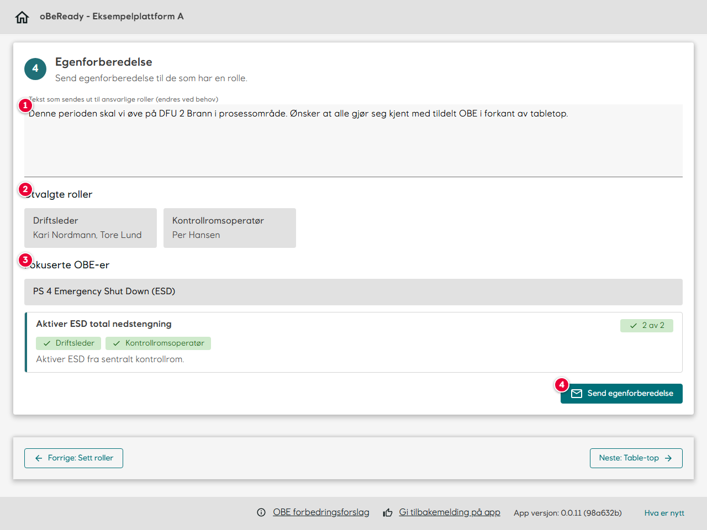

1. **Tekst** – appen foreslår en tekst. Endre den ved behov.
2. **Utvalgte roller** – rollene og personene som får egenforberedelsen.
   Mangler noen e-postadresse eller kobling til bruker, får du en melding om
   at de ikke blir varslet.
3. **Fokuserte OBE-er** – OBE-ene, med rollene som har ansvar for hver. En
   grønn hake betyr at rollen har en ansvarlig.
4. Velg **Send egenforberedelse**.

Bekreft sendingen i dialogen som kommer opp:

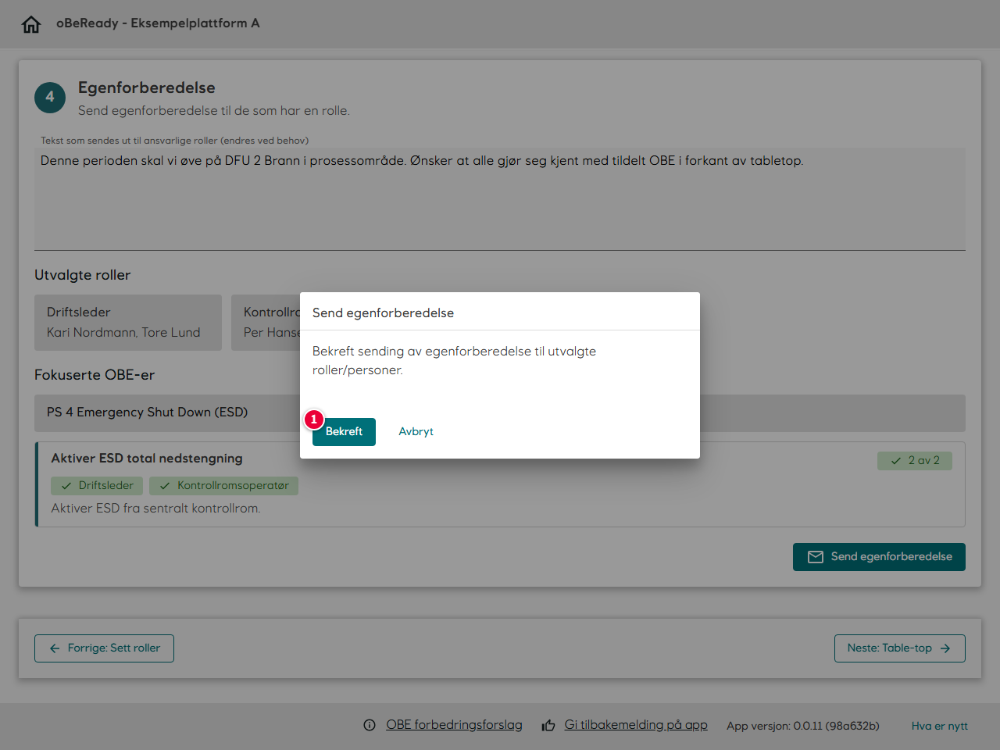

1. Velg **Bekreft**.

### Følg med på hvem som har bekreftet

Når egenforberedelsen er sendt, ser du teksten som ble sendt, og en liste over
mottakerne:

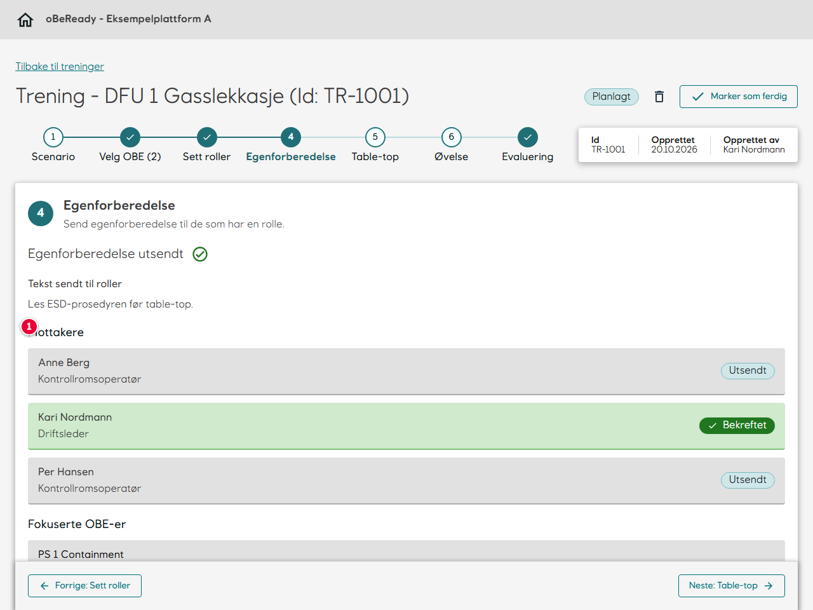

1. **Mottakere** – status for hver person:
   - **Utsendt** – kortet er sendt i Teams, men ikke bekreftet ennå.
   - **Bekreftet** – personen har bekreftet. Raden blir grønn.
   - **Ikke levert** – kortet kom ikke frem i Teams.

Når en mottaker bekrefter, blir det også registrert som utsjekk av OBE-ene for
rollen deres (se kapittel 14).

## 9. Steg 5 – Table-top

Table-top-steget er en presentasjon du kan vise på skjerm sammen med
deltakerne.

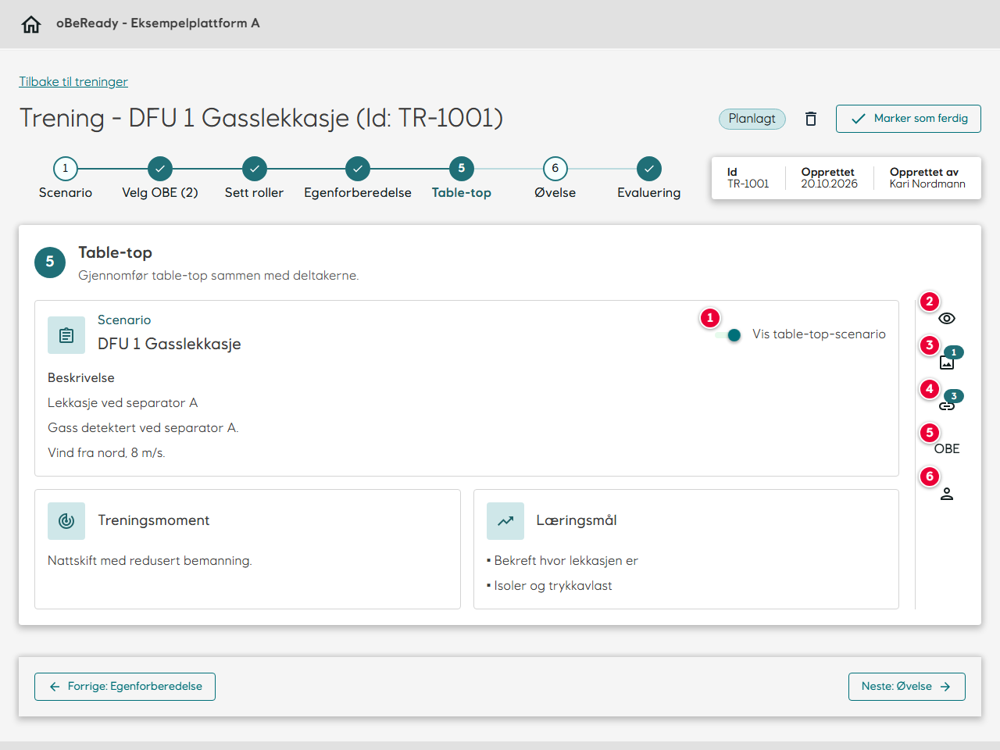

1. **Vis table-top-scenario** – slå på for å vise beskrivelsen. Den er skjult
   til du slår den på, så du kan vise den når det passer.
2. **Øyet** – vis presentasjonen i fullskjerm.
3. **Bilder** – vis bildene til høyre. Tallet viser hvor mange det er. Velg et
   bilde for å se det stort.
4. **Lenker** – vis lenkene til høyre.
5. **OBE** – vis de fokuserte OBE-ene.
6. **Personen** – registrer hvem som deltok på table-top.

Under scenarioet ser du **Treningsmoment** og **Læringsmål**.

### Fullskjerm

I fullskjerm skjules resten av appen. Knapperaden får tekst, slik at den er
lett å bruke foran deltakerne.

1. Velg **Avslutt fullskjerm** når du er ferdig.

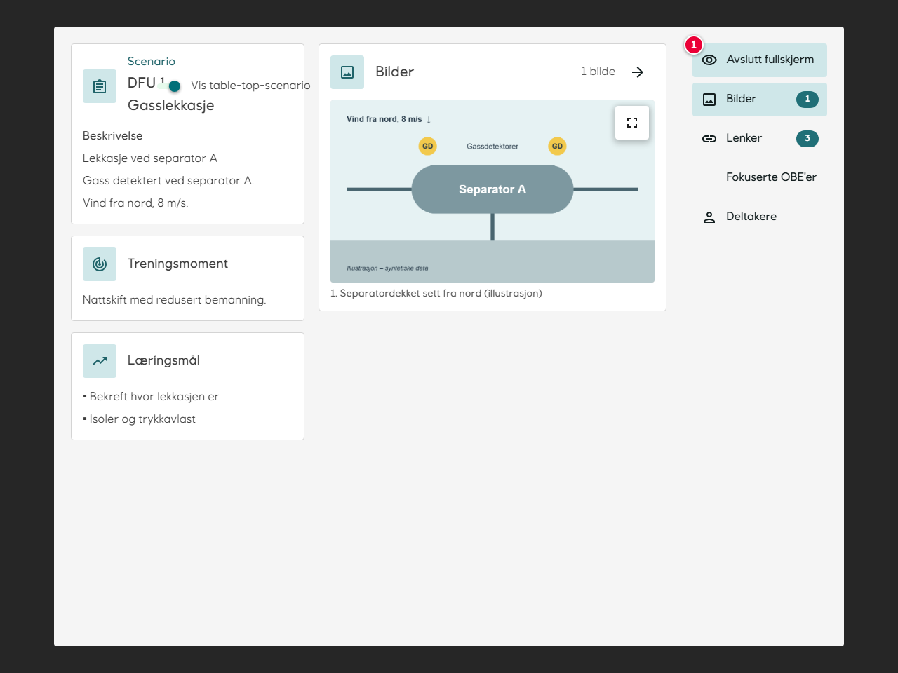

### Registrer deltakere

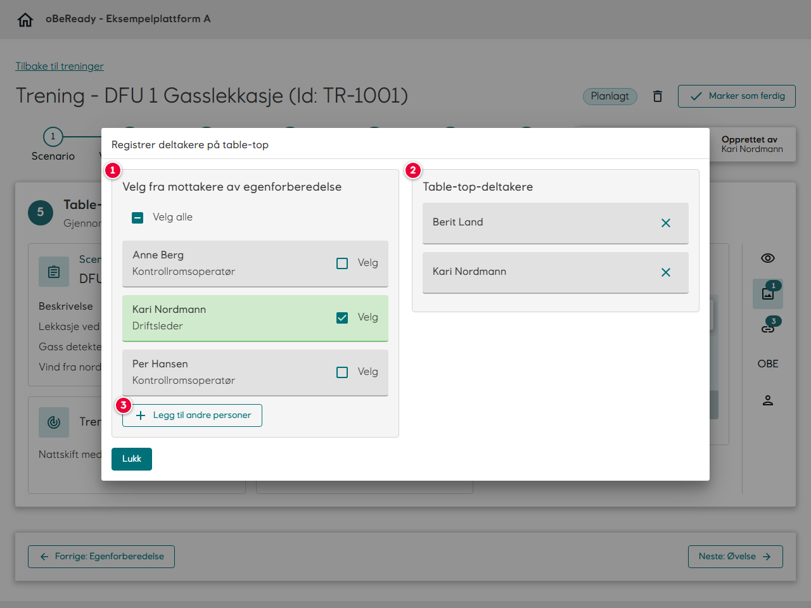

1. **Velg fra mottakere av egenforberedelse** – kryss av for dem som deltok,
   eller bruk **Velg alle**.
2. **Table-top-deltakere** – de som er registrert. Velg krysset for å fjerne
   en person.
3. **Legg til andre personer** – legg til noen som ikke fikk
   egenforberedelsen.

Endringene lagres med en gang. Velg **Lukk** når du er ferdig.

## 10. Steg 6 – Øvelse

Øvelsen fungerer som table-top: slå på **Vis øvelsesscenario** for å vise
beskrivelsen av øvelsen, og bruk knapperaden til høyre for fullskjerm, bilder,
lenker og OBE-er. Øvelsen har ingen deltakerregistrering.

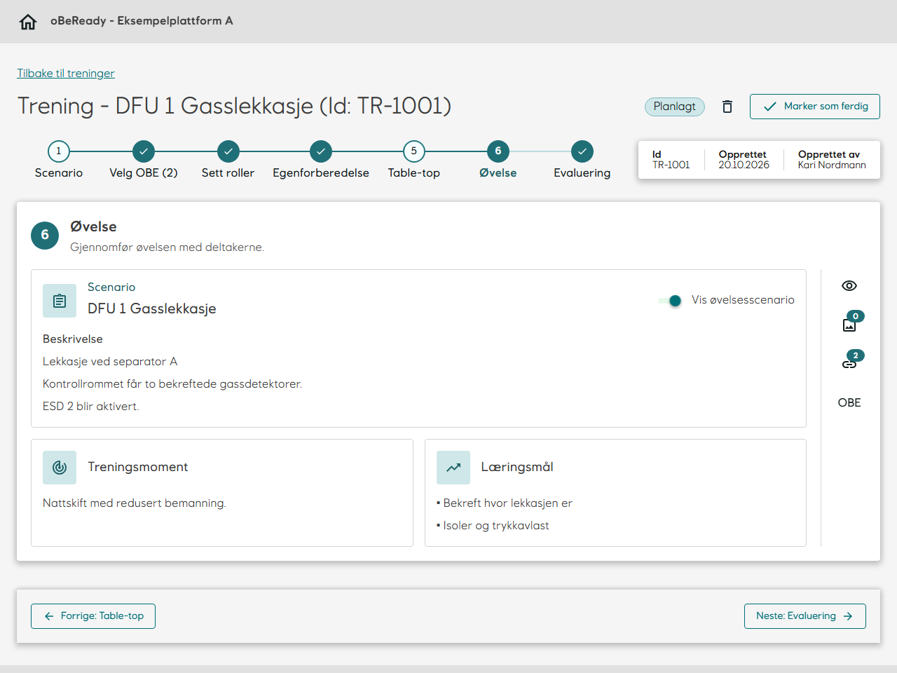

## 11. Steg 7 – Evaluering

Etter øvelsen sender du ut en evaluering. Hver person du velger, får et kort i
Teams med tre spørsmål: *Hva fungerte godt?*, *Lagets forbedringspunkter* og
*Bedre læring*.

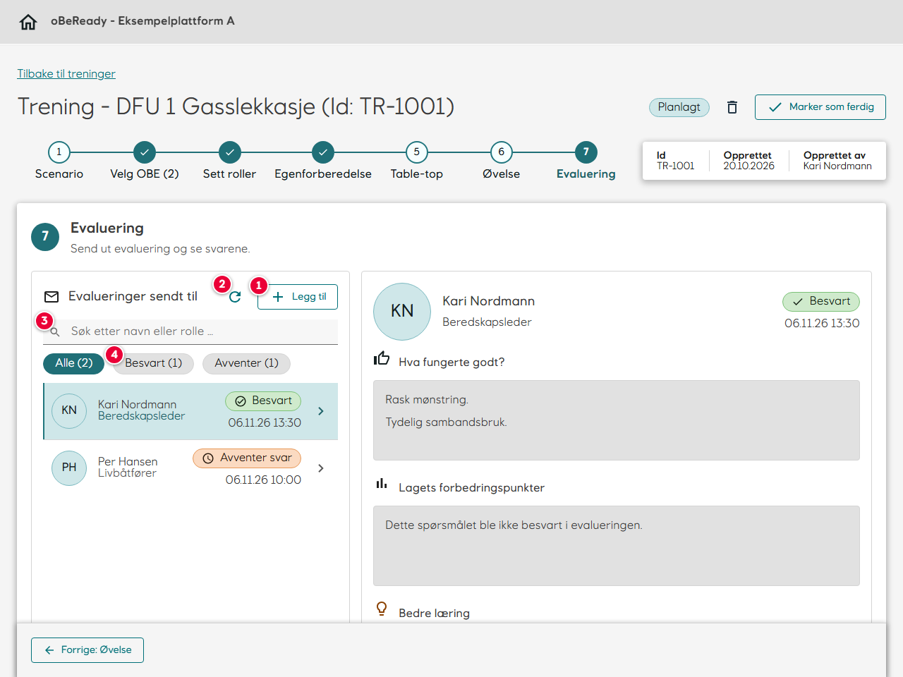

1. **Legg til** – send evaluering til flere. Før noen har fått den, heter
   knappen **Send ut evalueringer**.
2. **Oppdater** – hent nye svar.
3. **Søk** – søk etter navn eller rolle.
4. **Besvart / Avventer** – vis bare dem som har svart, eller dem som ikke har
   svart ennå.

Velg en person i listen for å se svarene til høyre.

### Send ut evalueringer

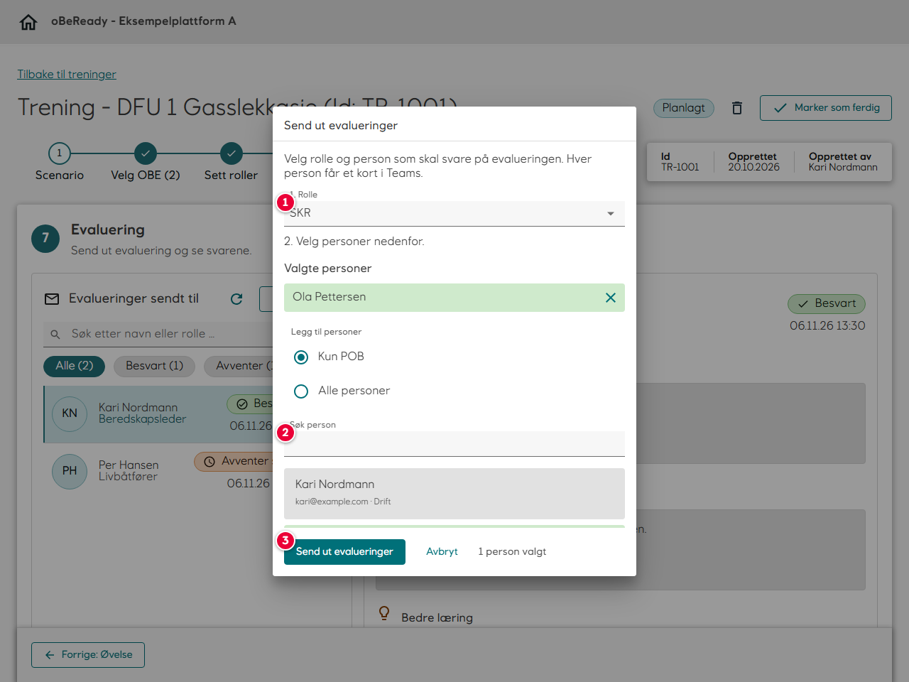

1. **Rolle** – velg rollen personene skal svare som.
2. Søk opp og velg personene. De vises under **Valgte personer**.
3. Velg **Send ut evalueringer**.

Appen spør ingen to ganger. Har en person allerede fått evalueringen, blir
personen hoppet over.

## 12. Fullfør, åpne eller slett en trening

Knappene ligger øverst til høyre på treningssiden. Bare den som opprettet
treningen, ser dem.

### Marker som ferdig

1. Velg **Marker som ferdig**.
2. Velg **Fullfør**.

Treningen får status *Gjennomført* og kan ikke endres. Du kan fortsatt sende ut
evalueringer.

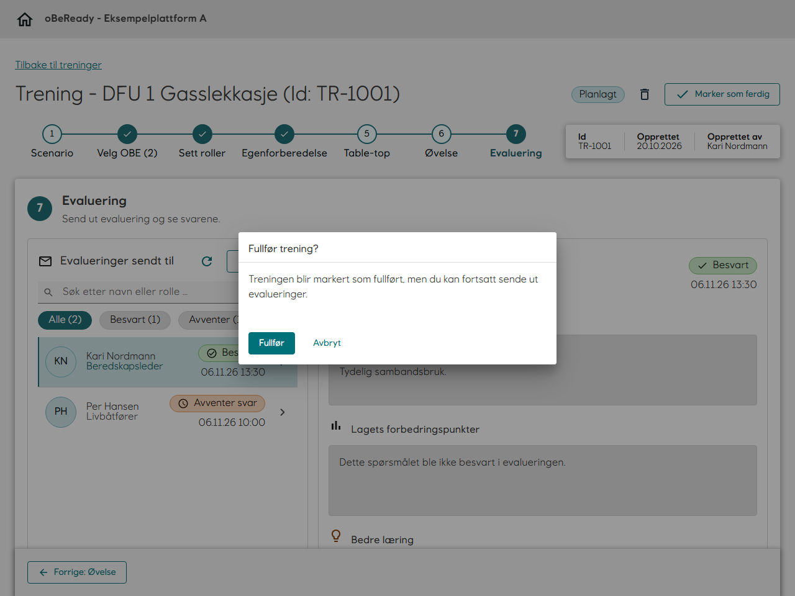

### Åpne en ferdig trening igjen

Velg **Åpne trening** og bekreft med **Åpne**. Treningen kan endres igjen.

### Slett en trening

1. Velg søppelbøtta (**Slett**).
2. Velg **Slett** i dialogen.

Treningen fjernes fra oversikten, men innholdet blir ikke slettet.

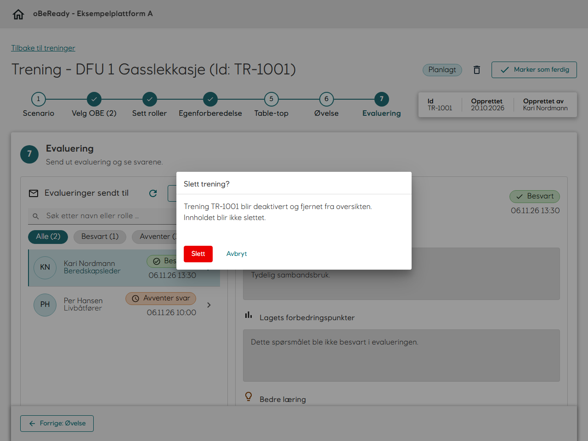

## 13. Treningsmatrise

Treningsmatrisen viser hvilke OBE-er som hører til et scenario, og hvilke
roller som har ansvar for dem.

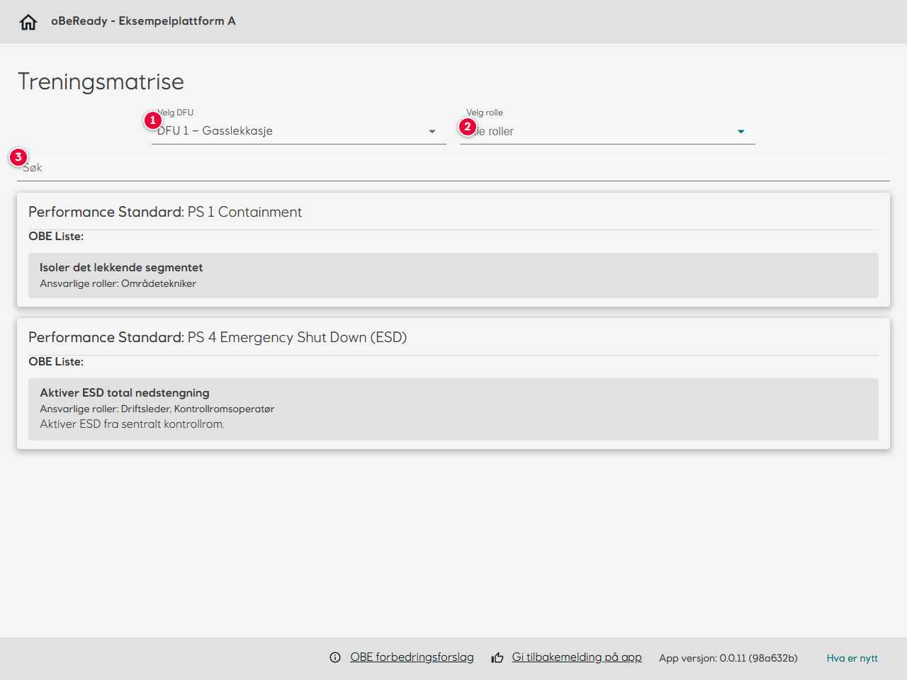

1. **Velg DFU** – velg scenario.
2. **Velg rolle** – vis bare OBE-ene for én rolle. Appen husker valget.
3. **Søk** – søk i OBE-ene.

## 14. Årlig utsjekk per rolle

Hvert år bekrefter du at du kjenner OBE-ene for rollene dine. Utsjekken er
gyldig i ett år.

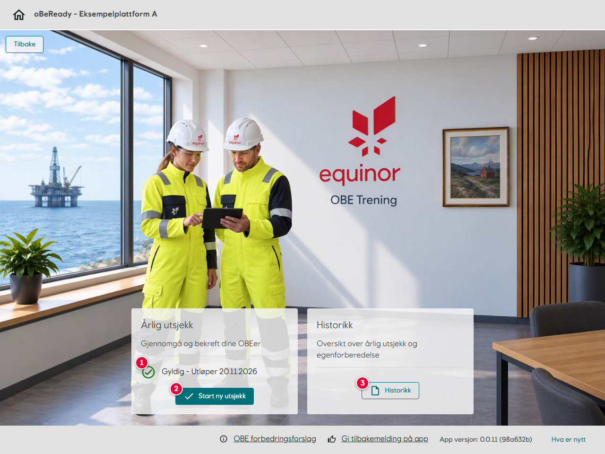

1. **Status** – en av disse:
   - **Gyldig – Utløper …** – du har en gyldig utsjekk.
   - **Klar til gjennomføring** – du kan gjøre utsjekken nå.
   - **Årlig utsjekk ikke utført** – under står det når du kan gjøre den.
2. **Start ny utsjekk** – start utsjekken. Knappen er grå til perioden for
   utsjekk har startet.
3. **Historikk** – se tidligere utsjekker.

### Steg 1 – velg roller

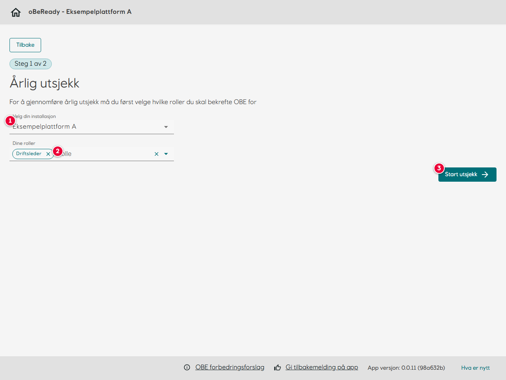

1. **Velg din installasjon** – sjekk at riktig anlegg er valgt.
2. **Dine roller** – velg én eller flere roller du skal bekrefte OBE-er for.
3. Velg **Start utsjekk**.

### Steg 2 – gå gjennom OBE-ene

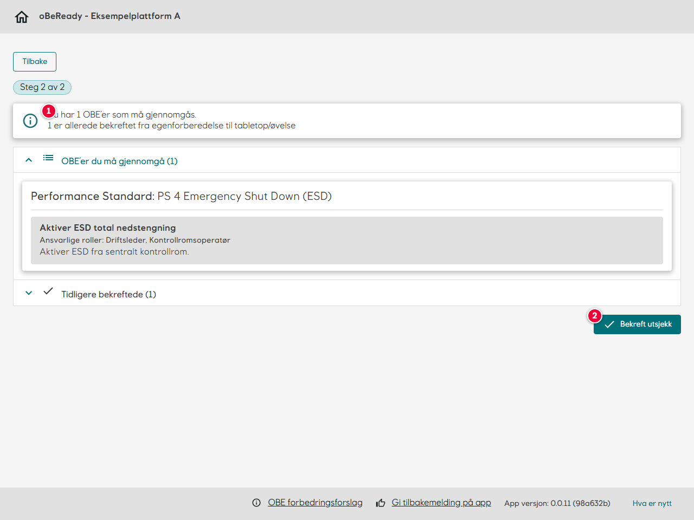

1. Øverst ser du hvor mange OBE-er du må gå gjennom. OBE-er du allerede har
   bekreftet gjennom egenforberedelse i år, trenger du ikke gå gjennom igjen.
   De ligger under **Tidligere bekreftede**.
2. Les gjennom OBE-ene, og velg **Bekreft utsjekk**.

Bekreft i dialogen:

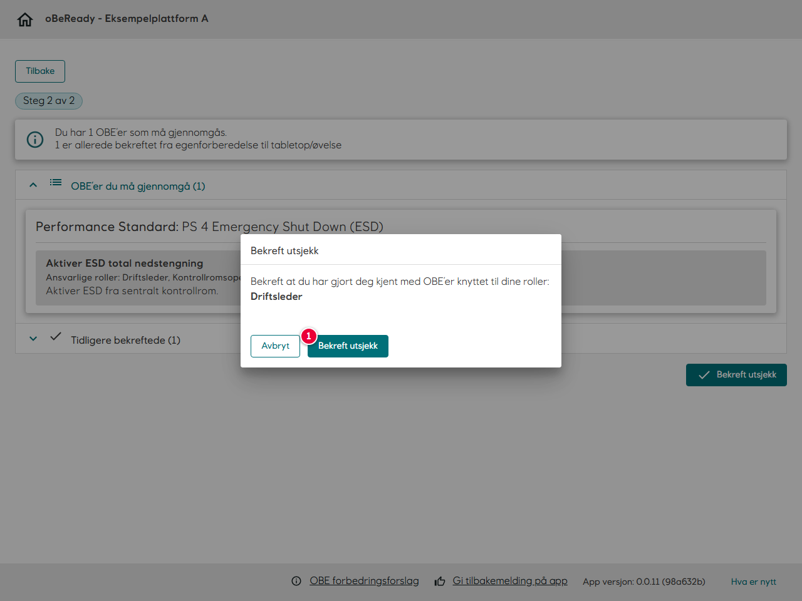

1. Velg **Bekreft utsjekk**.

### Historikk

Etter utsjekken ser du **Årlig utsjekk fullført** og en oversikt per år. Den
viser om årlig utsjekk er gjort, hvor lenge den gjelder, og hvor mange
egenforberedelser du har bekreftet.

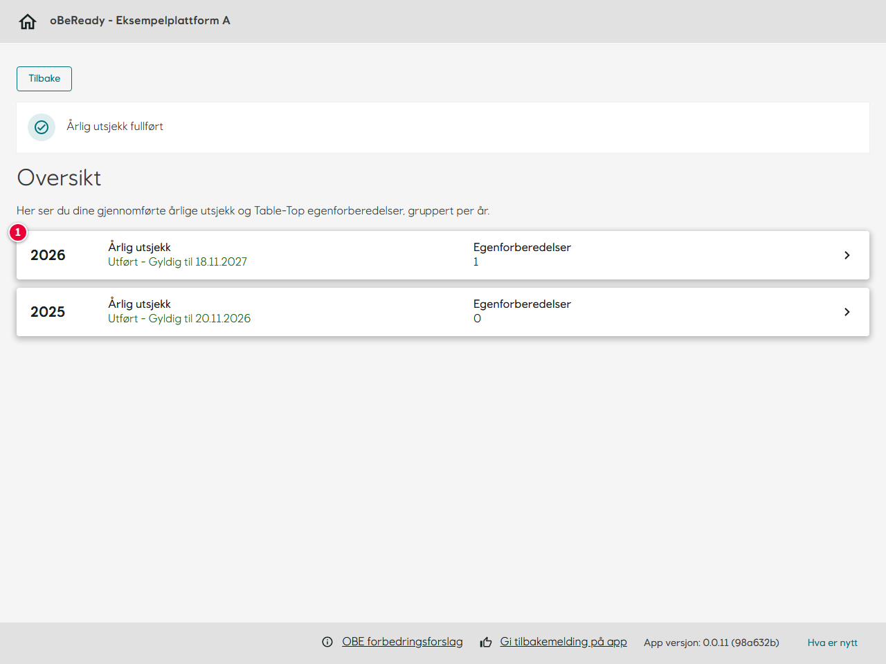

1. Velg et år for å se årsoppsummeringen.

I årsoppsummeringen ser du hver utsjekk med dato og type. Velg en rad for å se
OBE-ene som ble bekreftet.

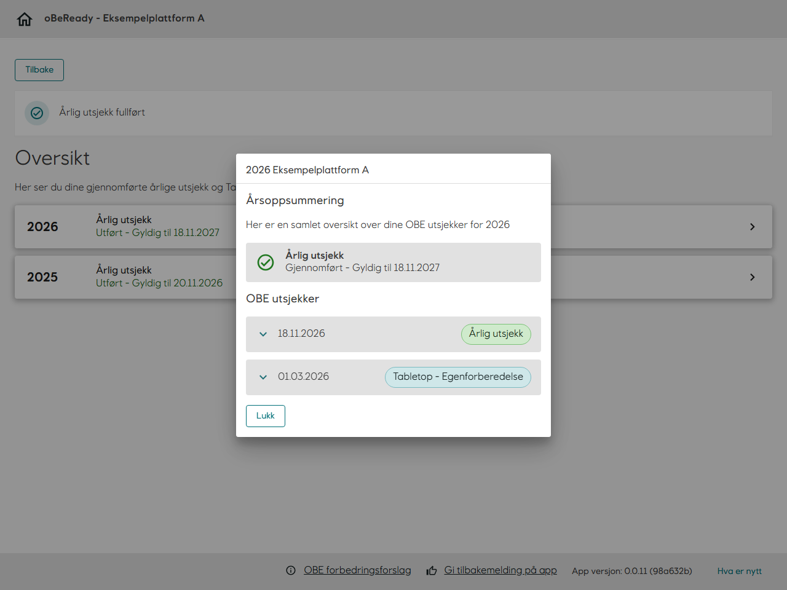

## 15. Hva er nytt og tilbakemelding

Nederst i appen finner du:

- **OBE forbedringsforslag** – lenke for å foreslå forbedringer av OBE-er.
- **Gi tilbakemelding på app** – si fra om feil eller ønsker for appen.
- **App versjon** – versjonen du bruker. Oppgi den når du gir tilbakemelding.
- **Hva er nytt** – hva som er endret i hver versjon.

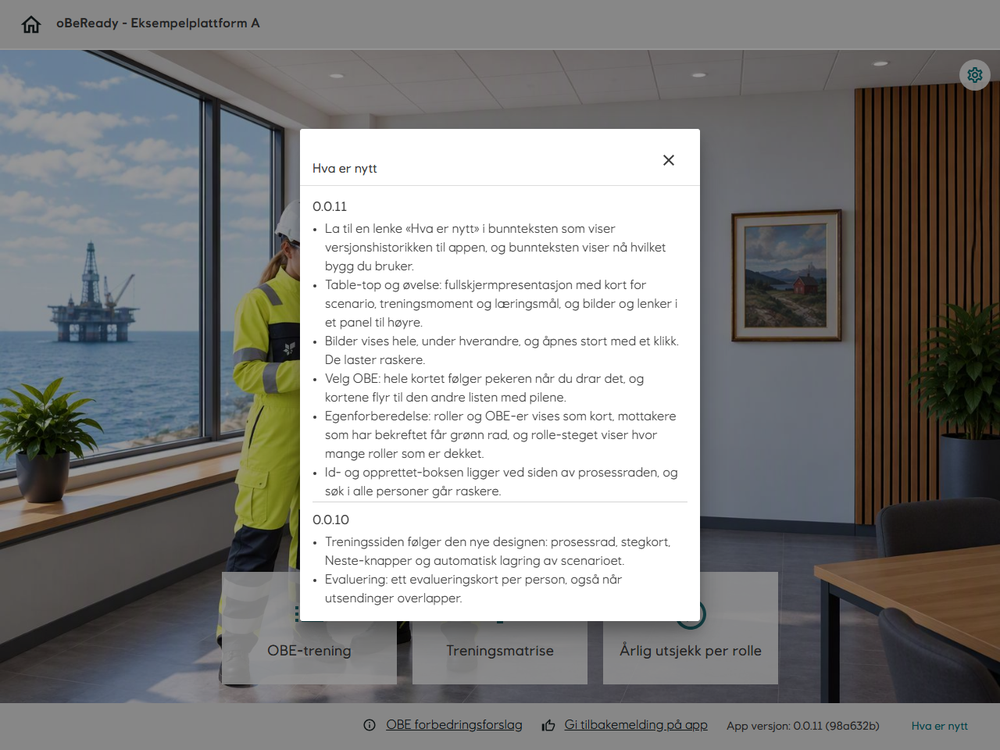

## 16. Spørsmål og svar

**Jeg finner ikke treningen min.**
Sjekk at du har valgt riktig anlegg (tannhjulet på startsiden). Velg
**Nullstill filtre** i oversikten. En slettet trening vises ikke i oversikten.

**Jeg kan ikke endre noe på treningen.**
Treningen er markert som ferdig. Den som opprettet treningen, kan åpne den
igjen med **Åpne trening**.

**Jeg kan ikke endre OBE-ene eller rollene.**
De låses når egenforberedelsen er sendt ut, slik at mottakerne og OBE-ene
stemmer med det som ble sendt.

**En person får ikke egenforberedelsen eller evalueringen.**
Personen mangler e-postadresse eller er ikke koblet til en Equinor-bruker.
Bruk **Tilknytt bruker** i rolledialogen (se kapittel 7).

**En mottaker har status «Ikke levert».**
Kortet kom ikke frem i Teams. Kontakt personen direkte, eller si fra med
**Gi tilbakemelding på app**.

**Jeg ser ikke knappene «Marker som ferdig» og «Slett».**
Bare den som opprettet treningen, ser dem.

**Knappen «Start ny utsjekk» er grå.**
Perioden for årlig utsjekk har ikke startet. Datoene står under statusen.
